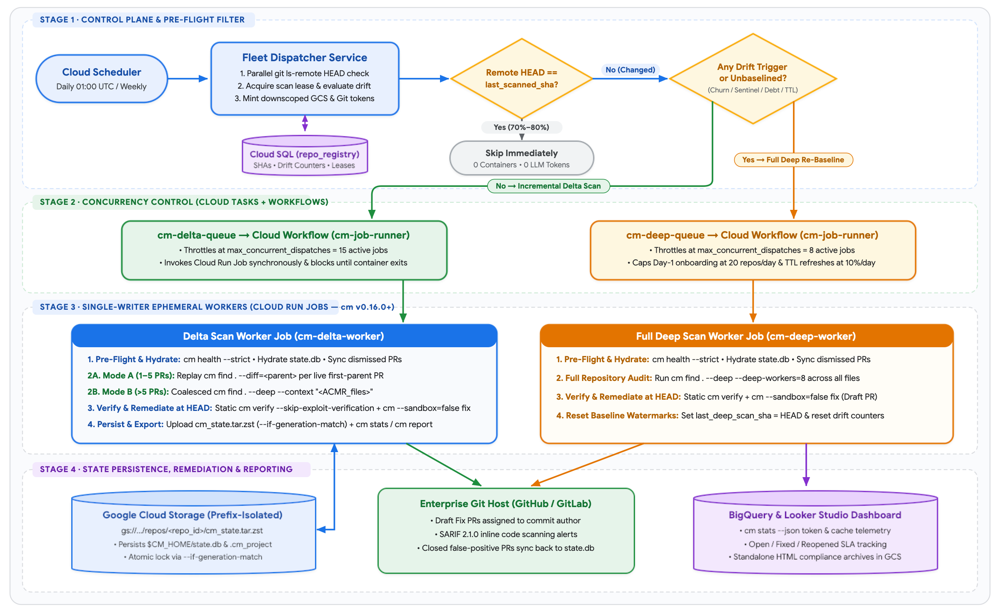
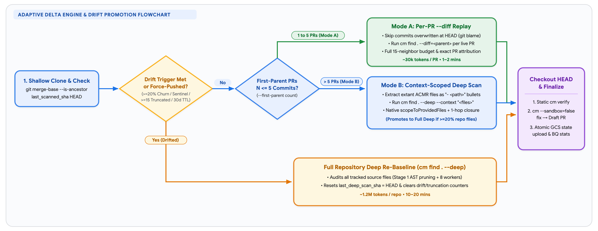

# Continuous Multi-Repository Security Monitoring with CodeMender

**Author:** Kui Luo (`kuiluo@`)  
**Status:** Draft  
**Target Scale:** 100–500 Enterprise Repositories (`cm` v0.16.0+)

---

## 1. Executive Summary

### 1.1 Problem Statement
Enterprise security teams adopting **CodeMender (`cm` v0.16.0+)** want to scan **100 to 500 repositories** on a recurring daily or weekly schedule from a central Google Cloud control plane, without modifying per-repository CI/CD pipelines. Running `cm` at fleet scale exposes four technical gaps:

1. **Redundant Scans on Unchanged Code**: On a typical workday, 70%–80% of enterprise repositories have zero new commits, and active repositories modify <2% of their files. Running `cm find . --deep` across every repository daily wastes ~90% of LLM tokens re-auditing unchanged code.
2. **The `cm --diff` Single-PR Neighbor Cap (`--diff-max-neighbors=10`)**: `cm find . --diff=<base_ref>` was designed for a single pull request and caps 1-hop caller/callee neighbor inspection at 10 files (configurable to 15). Running a single cumulative `--diff` across a full day or week of merged commits truncates neighbor expansion (`WARNING: Impact expansion truncated`) and flattens commits from multiple authors into one unattributed diff.
3. **Ephemeral Container State Loss & Write Races**: CodeMender tracks finding lifecycles (`OPEN`, `FIXED`, `DISMISSED`, `REOPENED`) in a local SQLite database (`$CM_HOME/state.db`) bound to `<repo_root>/.cm_project`. Stateless workers either lose dismissed false positives between runs or overwrite each other's SQLite database if jobs overlap.
4. **Silent Repository Drift**: Relying exclusively on 1-hop incremental delta scans misses vulnerabilities introduced by 3+ hop dataflow changes, global auth/middleware edits, or accumulated neighbor truncations.

### 1.2 Proposed Architecture Summary
* **Pre-Flight Remote SHA Filter (`git ls-remote`)**: Polls remote `HEAD` SHAs in parallel before launching containers, skipping unchanged repositories (~70%–80% daily) at zero compute and zero token cost.
* **Blocking Concurrency Control (Cloud Tasks + Cloud Workflows)**: Throttles concurrent repository scans (`15` delta workers / `8` deep workers) by routing Cloud Tasks through a blocking **Cloud Workflow (`cm-job-runner`)** that invokes **Cloud Run Jobs** synchronously and waits for container exit.
* **Two-Mode Delta Engine (Cutoff at $N = 5$ Merged PRs)**:
  * *Mode A ($1 \le N \le 5$ PRs)*: Replays `cm find . --diff=<parent_sha>` per surviving first-parent PR (skipping commits whose touched lines were completely overwritten at `HEAD`), preserving the 15-neighbor budget and exact PR attribution.
  * *Mode B ($N > 5$ PRs)*: Extracts extant modified source files (`git diff --name-only --diff-filter=ACMR`) as markdown bullets (`- <path>`) and passes them via `cm find . --deep --context ...`, invoking CodeMender's native `scopeToProvidedFiles` engine across those files and their 1-hop dependency closure (or promoting to full `--deep` if $\ge 20\%$ of repo files changed).
* **Four-Trigger Drift Promotion & Single-Writer GCS State**: Automatically promotes drifted repositories to a full `cm find . --deep` re-baseline based on source churn ($\ge 20\%$), security sentinel edits / cooldown-gated manifest updates, neighbor truncation debt ($\ge 15$ files), or baseline TTL (`30–60 days`). Each job hydrates and atomically uploads `$CM_HOME/state.db` in GCS (`--if-generation-match`).

### 1.3 End-to-End Architecture Flow



---

## 2. CodeMender (`cm` v0.16.0+) Primitives & Goals

CodeMender (`cm` v0.16.0+) runs a lightweight CLI worker that manages local SQLite state (`$CM_HOME/state.db`) and dispatches analysis sessions to the Gemini Enterprise Agent Platform (`gemini-3.8-flash` default; `gemini-3.8-flash-cyber` and `gemini-4-argon` for verification and high-assurance scans).

| Scan Primitive | CLI Invocation (`v0.16.0+`) | Scope Audited | Workers | Avg Latency & Tokens | Fleet Monitoring Role |
| :--- | :--- | :--- | :---: | :--- | :--- |
| **Single-PR Diff** | `cm find . --diff=<ref>` | Modified hunks + 1-hop neighbors (cap 10–15) | 4 | **1–2 mins**<br/>~30k tokens / PR | **Mode A**: Per-PR replay ($1 \le N \le 5$ PRs) |
| **Context-Scoped Deep** | `cm find . --deep -c "<files>"` | Extant changed files (`parseContextCandidates`) + 1-hop closure | 8 | **2–5 mins**<br/>~150k–180k tokens | **Mode B**: Coalesced delta ($N > 5$ PRs, $<20\%$ files) |
| **Full Repo Deep** | `cm find . --deep` *(default)* | All tracked source files after Stage 1 Tree-Sitter AST pruning | 8 | **10–20 mins**<br/>~1.2M tokens | **Onboarding & Drift Re-Baseline** |

> **Why Static Verify + Non-Sandboxed Fix Is Default**: `cm find --deep` already applies Stage 1 Tree-Sitter AST pruning and Stage 2 micro-batch verification (<2% false-positive rate). Because dynamic exploit verification (`cm verify`) requires a working per-repository build container (`build.command`), workers default to static verification (`cm verify --skip-exploit-verification --no-reset`) and non-sandboxed patch synthesis (`cm --sandbox=false fix <id> --yes` delivered as a **Draft PR**), with dynamic sandbox verification enabled opt-in for Tier-1 repositories.

### 2.1 Goals & Non-Goals
* **Goals**:
  * **G1 — Fleet Scale**: Monitor 100–500 repositories on a daily or weekly schedule, completing daily fleet sweeps in **< 45 minutes**.
  * **G2 — Full 1-Hop Coverage & Attribution**: Prevent neighbor truncation on multi-PR windows and attribute each finding to the introducing commit.
  * **G3 — Noise-Resistant Re-Baselining**: Promote drifted repositories to `cm find . --deep` without false triggers from lockfiles or Dependabot bumps.
  * **G4 — Conflict-Free State Continuity**: Preserve `OPEN`, `FIXED`, `DISMISSED`, and `REOPENED` state across ephemeral runs with zero SQLite race conditions.
* **Non-Goals**:
  * **NG1**: Inline synchronous CI/CD pull-request blocking.
  * **NG2**: Third-party SAST / Wiz report ingestion (`cm report import`).
  * **NG3**: Requiring application teams to build custom Docker build containers to onboard repositories.

---

## 3. Control Plane & Concurrency Design

1. **Fleet Dispatcher**: Triggered by Cloud Scheduler, the Dispatcher queries `repo_registry` in Cloud SQL and executes parallel `git ls-remote <repo_url> HEAD` checks (< 5 seconds for 200 repos). Repositories where `remote_head_sha == last_scanned_sha` (and within baseline TTL) are skipped immediately. For changed repositories, the Dispatcher acquires a 90-minute lease (`active_scan_lease_until`), evaluates the Drift Triggers (Section 5), mints a **prefix-downscoped GCS token** restricted to `gs://<bucket>/repos/<repo_id>/*`, and enqueues a task deduplicated by `<repo_id>-<head_sha>`.
2. **Why Cloud Tasks + Cloud Workflows (`cm-job-runner`) Is Required**: Calling the Cloud Run Jobs API (`POST .../jobs/<job>:run`) directly from an HTTP Cloud Task returns `200 OK` in ~150ms as soon as the job is *created*, which would cause Cloud Tasks to dispatch all 100+ jobs simultaneously and exhaust Vertex AI quotas. Conversely, running scans inside a synchronous Cloud Run *Service* hits Cloud Tasks' 30-minute HTTP timeout on large `--deep` scans. Routing Cloud Tasks through a blocking **Cloud Workflow (`cm-job-runner`)** with `max_concurrent_dispatches = 15` (delta) and `8` (deep) polls job completion (up to 60+ minutes) and only returns `200 OK` to Cloud Tasks when the container exits.
3. **Single-Writer Cloud Run Jobs**: Each worker runs a zero-cost credential check (`CM_TASK_AGENT_ID=<id> cm health --strict --json`), hydrates `$CM_HOME/state.db` from GCS, syncs dismissed PRs, executes `cm find`, runs static `cm verify` and `cm --sandbox=false fix` at `HEAD`, and uploads `cm_state.tar.zst` once with `--if-generation-match`.

### 3.1 Alternatives Considered

| Alternative | Pros | Why Rejected |
| :--- | :--- | :--- |
| **1. Per-Repo GitHub Actions / GitLab CI Cron** | Zero GCP orchestration to deploy. | Requires committing and maintaining workflow YAML files and GCP credentials across 100–500 repositories; no cross-repo concurrency throttling against shared Vertex AI quotas. |
| **2. Single Sequential Cloud Run Job** | Simplest infra (1 Job + GCS). | Too slow and brittle at 100+ repos (~3 hours sequential runtime; one container OOM kills the entire fleet run). |
| **3. Cloud Workflows `parallel` Only (No Cloud Tasks)** | Removes Cloud Tasks. | Cloud Workflows' `parallel` block caps concurrent branches (20) and lacks per-repository queue retry backoffs, dead-lettering, and task deduplication. |
| **4. Direct Cloud SQL Backend for `cm`** | Eliminates GCS `state.db` hydration. | Incompatible with the `cm` v0.16.0+ binary, which reads and writes local SQLite (`$CM_HOME/state.db`) directly during `find`, `verify`, `fix`, and `report`. |

---

## 4. Daily & Weekly Delta Scans: Two-Mode Delta Engine

### 4.1 The 5-PR Crossover Point & Routing Flow
A single-PR `--diff` scan takes ~1.5 minutes and ~30k tokens, whereas a Context-Scoped Deep Scan (`cm find . --deep --context <files>`) across 10–15 modified files takes ~3.5 minutes and ~150k–180k tokens. Once a repository merges **more than 5 PRs** in a window ($5 \times 30\text{k} = 150\text{k tokens}$), commits frequently touch overlapping files or shared neighbors—making a single coalesced Context-Scoped Deep Scan faster and cheaper than replaying each commit.

After cloning (`git clone --shallow-since=<last_deep_scan_date>`) and verifying commit ancestry (`git merge-base --is-ancestor <last_scanned_sha> HEAD`), the worker counts first-parent commits (`N = git rev-list --first-parent --count <last_scanned_sha>..HEAD`) and routes execution at **$N = 5$**:



### 4.2 Mode A: Per-Commit `--diff` Replay ($1 \le N \le 5$ First-Parent Commits)
1. **Live-at-`HEAD` Hunk Guard**: Before checking out intermediate commit $C_i$, the worker runs `git diff -U0 <C_{i-1}> <C_i>` and checks via `git blame -L <start>,<end> HEAD -- <file>` that at least one modified line still survives at `HEAD`. Commits completely reverted or overwritten later in the same window are skipped.
2. **Per-PR Execution**: For each surviving commit $C_i$ (with parent $C_{i-1}$), the worker checks out $C_i$ and runs:
   ```bash
   cm find . --diff="${C_prev}" --diff-depth=1 --diff-max-neighbors=15 --diff-workers=4 --yes
   ```
3. **Deferred Verification at `HEAD`**: All replay steps share `$CM_HOME/state.db`, recording which commit $C_i$ first introduced each finding fingerprint. Once replay finishes, the worker checks out `HEAD` and verifies only findings that remain `OPEN` at `HEAD`.

### 4.3 Mode B: Coalesced Context-Scoped Deep Scan ($N > 5$ First-Parent Commits)
1. **Extant Source File Extraction (`--diff-filter=ACMR`)**: Lists surviving modified source files in `<last_scanned_sha>..HEAD` as markdown bullets while excluding deleted (`D`) files and lockfiles:
   ```bash
   CHANGED_FILES=$(git diff --name-only --diff-filter=ACMR "$LAST_SHA..$TARGET_SHA" -- \
     . ':!*.lock' ':!package-lock.json' ':!go.sum' ':!vendor/' | sed 's/^/- /')
   ```
2. **Native `--context` File Scoping (`scopeToProvidedFiles`)**: In `cm` v0.16.0+, `cm find <path>` accepts at most 1 positional argument (`cobra.MaximumNArgs(1)`). Passing `.` as `<path>` and providing markdown-bulleted file paths (`- path/to/file.py`) in `--context` triggers `discoverAndScopeFindFiles` $\rightarrow$ `scopeToProvidedFiles` (`parseContextCandidates` + `resolveProvidedFileNeighbors`), scoping `--deep` exclusively to those files and their 1-hop dependency closure while keeping `.` as the workspace root. If modified source files reach $\ge 20\%$ of repository files, the worker promotes the scan to an unscoped full `cm find . --deep`; otherwise it runs:
   ```bash
   cm find . --deep --deep-workers=8 --yes --format=json \
     --context "$(printf 'Audit modified files:\n%s' "$CHANGED_FILES")"
   ```
3. **Post-Scan Attribution**: Net-new findings in Mode B are mapped to their introducing commit and author via `git log -n 1 -L <start>,<end>:<file> <last_scanned_sha>..HEAD`.

---

## 5. Repository Drift Detection: When to Re-Baseline with `--deep`

Because a Context-Scoped Deep Scan inspects each modified file plus 2–3 neighbor files, once **20% of a repository's source files** have changed, their 1-hop closures span 60%–80% of the codebase. The Fleet Dispatcher promotes a repository to a full `cm find . --deep` scan (and resets all drift watermarks) when **any** of four triggers is met:

1. **Trigger 1 — First-Party Source Code Churn ($\ge 20\%$ Source Files or $\ge 25\%$ Source LOC)**:
   * Measured against `last_deep_scan_sha` while excluding lockfiles, vendor directories, generated files, and unit tests (`':!*.lock' ':!package-lock.json' ':!go.sum' ':!vendor/' ':!*_test.*'`), preventing 25,000-line lockfile updates from triggering deep scans.
2. **Trigger 2 — Security Sentinel Code Changes & Cooldown-Gated Manifest Updates**:
   * **Security Sentinel Code (Immediate `--deep`)**: Any edit to `**/auth/**`, `**/security/**`, `**/crypto/**`, or `**/middleware/**` immediately triggers a full `--deep` scan.
   * **Dependency Manifests (14-Day Cooldown Gate)**: Edits to `go.mod`, `package.json`, `requirements.txt`, `pom.xml`, or `build.gradle` promote to `--deep` **only if `now() - last_deep_scan_at >= 14 days`**, preventing daily/weekly Dependabot PRs from causing repeated full-repo scans.
3. **Trigger 3 — Accumulated Neighbor Truncation Debt ($\ge 15$ Skipped Files)**:
   * Parses `WARNING: Impact expansion truncated (X candidate files identified, capped at Y)` during `--diff` runs and accumulates $(X - Y)$ in `truncated_neighbors_since_deep`. Promotes to `--deep` once $\ge 15$ candidate neighbors have been skipped (or $>50\%$ in a single run).
4. **Trigger 4 — Maximum Baseline Age TTL (`30 Days` Tier-1 / `60 Days` Tier-2 & Tier-3)**:
   * Ensures periodic full-repo refreshes and recovers when history rewrites invalidate `last_deep_scan_sha`. Bucketed by `crc32(repo_id) % 30` and capped at **10% of the fleet per day** (with Day-1 onboarding capped at **20 repos/day**) to prevent token spikes.

---

## 6. State Persistence, Verification & Pipeline Controls

### 6.1 Conflict-Free GCS State Locking & Closed-Loop Dismissal Sync
* **Database Lease + GCS Generation Preconditions**: The Dispatcher sets `active_scan_lease_until = now() + 90m` in Cloud SQL before enqueuing. The worker records the GCS `generation` number (`G`) when downloading `gs://<bucket>/repos/<repo_id>/cm_state.tar.zst` and uploads the updated archive with `gcloud storage cp ... --if-generation-match=G`, ensuring any zombie writer fails with HTTP `412 Precondition Failed`.
* **Closed-Loop PR Dismissal Sync**: Before scanning, the worker queries the VCS API for previously opened CodeMender PRs/issues closed with `false-positive` or `wontfix` labels and updates `$CM_HOME/state.db` (`UPDATE findings SET status='DISMISSED', dismiss_reason='Closed via PR review', updated_at=? WHERE finding_id=?`).
* **Mid-Run Checkpoint Recovery**: An `EXIT` trap uploads intermediate `state.db` progress and advances `last_scanned_sha` to the last completed commit $C_i$ if a Mode A run is interrupted mid-window.

### 6.2 Verification, Controls & Reporting Channels
* **Default Static Verification & Draft PRs**: Net-new `CRITICAL` and `HIGH` findings at `HEAD` run `cm verify <id> --skip-exploit-verification --no-reset --model=gemini-3.8-flash-cyber --yes`. Confirmed findings run `cm --sandbox=false fix <id> --yes` and open a **Draft PR** (or Security Issue) assigned to the attributed commit author so uncompiled patches never break CI merge queues.

| Surface / Channel | Mechanism & Capabilities |
| :--- | :--- |
| **Control 1: Fleet Manifest (`repos.yaml`)** | GitOps/GCS manifest controlling `enabled`, `risk_tier` (`tier-1` vs. `tier-2/3`), `schedule` (`daily` \| `weekly`), `delivery_mode` (`draft_pr` \| `issue_only` \| `report_only`), `team_id`, and custom `sentinel_globs` (plus `subpath` for monorepos). |
| **Control 2: On-Demand API & PR Labels** | `POST /v1/scan` forces an immediate repo scan; `gcloud tasks queues pause` acts as an emergency kill-switch; closing a Draft PR with `false-positive` mutes the finding in `state.db`. |
| **Report 1: Looker Studio / BigQuery** | Worker exports `cm stats --json --since=24h` and `cm report --format=json` to BigQuery (`scan_telemetry`, `finding_events`) to track token spend, cache hit rate, drift frequency, and MTTR by `--team-id`. |
| **Report 2: GitHub / GitLab SARIF & HTML** | Worker uploads `cm report --format=sarif` to GitHub/GitLab Code Scanning for inline PR/branch annotations and archives standalone interactive bundles (`cm report --format=html --patches --artifacts`) in GCS. |

### 6.3 Operational Edge Cases & Mitigations

| Edge Case | Mitigation |
| :--- | :--- |
| **1. Force-Push / Rebased Branch** | If `git merge-base --is-ancestor <last_scanned_sha> HEAD` is false, falls back to `last_deep_scan_sha` or promotes to full `--deep`. |
| **2. Overlapping Repo Jobs** | Blocked by Cloud SQL `active_scan_lease_until` and GCS `--if-generation-match` atomic upload preconditions. |
| **3. Monorepos (>2,000 Files)** | Scoped via `subpath` in `repos.yaml` (e.g., `services/billing/`); each service is tracked and baselined independently. |
| **4. Non-Squashed Merge Commits** | Mode A uses `git rev-list --first-parent --reverse` so each merged PR is audited as one commit regardless of WIP branch commits. |

---

## Appendix A: Cost Estimation & Token Economics

### A.1 Monthly Steady-State Cost Comparison (100 Repositories — Baseline Model)
*Baseline Assumptions: 100 repositories averaging 250 source files (~50k LOC); 30% of repositories receive commits on a given workday (22 workdays/mo = 660 active repo-days/mo, averaging 2.5 PRs/day); 15% of repositories trigger a drift `--deep` scan per week (60 deep scans/mo).*

| Scanning Strategy | Monthly Scan Volume (100 Repos) | Est. Monthly Tokens | Est. LLM Cost | Est. GCP Infra Cost | **Total Monthly Cost** |
| :--- | :--- | :--- | :--- | :--- | :--- |
| **1. Naive Daily `--deep` on All Repos** | 3,000 full deep scans / mo | ~3,600M tokens | ~$2,520 / mo | ~$180 / mo | **~$2,700 / mo** |
| **2. Naive Weekly `--deep` on All Repos** | 430 full deep scans / mo | ~516M tokens | ~$361 / mo | ~$54 / mo | **~$415 / mo** |
| **3. Proposed Daily Delta + Drift `--deep`** | 2,100 skipped (`0` tokens)<br/>660 delta runs (~49.5M) + 60 deep runs (~72M)<br/>~70 verify/fix runs (~3.5M) | **~125M tokens** | **~$90 / mo** | **~$45 / mo*** | **~$135 / mo (95% saved)** |
| **4. Proposed Weekly Delta + Drift `--deep`** | 215 skipped (`0` tokens)<br/>155 delta runs (~19.5M) + 60 deep runs (~72M)<br/>~70 verify/fix runs (~3.5M) | **~95M tokens** | **~$68 / mo** | **~$35 / mo*** | **~$103 / mo (75% saved)** |

*\*Note: If a self-hosted Git server requires static egress IP allowlisting via Cloud NAT + VPC Direct Egress, add ~$38/mo in fixed GCP networking cost.*

### A.2 Sensitivity Analysis & Fleet Scaling (100–250 Repositories)

| Fleet Scenario | Active Repos / Workday | Avg Repo Size | One-Time Day-1 Onboarding Cost | Recurring Monthly Cost (Daily Schedule) | Avg Daily Fleet Runtime (15 Workers) |
| :--- | :--- | :--- | :--- | :--- | :--- |
| **Baseline (100 Repos)** | 30% (30 repos/day) | 250 files (~50k LOC) | **~$125** (~170M tokens) | **~$135 / mo** (~125M tokens) | **~15 mins / day** |
| **High-Velocity (100 Repos)** | **70% (70 repos/day, 5 PRs/day)** | 250 files (~50k LOC) | **~$125** (~170M tokens) | **~$245 / mo** (~270M tokens) | **~32 mins / day** |
| **Large Repos (100 Repos)** | 30% (30 repos/day) | **600 files (~120k LOC)** | **~$260** (~370M tokens) | **~$255 / mo** (~290M tokens) | **~28 mins / day** |
| **Enterprise Fleet (250 Repos)** | 30% (75 repos/day) | 250 files (~50k LOC) | **~$310** (~425M tokens) | **~$320 / mo** (~312M tokens) | **~35 mins / day** |

### A.3 Cost Estimation Rules, Benchmarks & Pricing Formulas

1. **Rule 1 — Empirical Token Usage per Operation** (derived from `cm stats --json` telemetry, [CodeMender Benchmark Telemetry Spreadsheet](https://docs.google.com/spreadsheets/d/12fNHoAU_rLDY7whWeBzMjNaFjHst9ldxg938Al6pK7w/edit?resourcekey=0-dmbHjLjY4XFcrdTLexG-ZA&gid=0#gid=0), and `go/codemender-rfc-20` on 250-file / 50k-LOC repositories):
   * **Full Deep Scan (`cm find . --deep`, 8 workers)**: ~125 2-file micro-batches after Stage 1 AST pruning $\times$ 9.6k tokens/batch (~8.5k input + ~1.1k output/thinking) = **~1.2M tokens/repo** (88% input, 12% output).
   * **Single-PR Diff Scan (`cm find . --diff`, 4 workers)**: 2–3 modified files + 4–6 1-hop neighbors (~3 micro-batches) = **~30k tokens/PR** (~75k tokens/active repo-day at 2.5 PRs/day).
   * **Context-Scoped Deep Scan (Mode B)**: ~12–15 extant modified files + 1-hop closure (~18 micro-batches) = **~180k tokens/run**.
   * **Static Verify + Patch Synthesis (`cm verify` + `cm fix`)**: **~50k tokens** per net-new `CRITICAL`/`HIGH` finding.
2. **Rule 2 — Vertex AI Gemini Flash Token Pricing (`gemini-3.8-flash` / `gemini-3.8-flash-cyber`)**:
   * Input tokens: **~$0.40 / 1M tokens**; Output & thinking tokens: **~$2.90 / 1M tokens**.
   * Blended rate at 88% input / 12% output: $(0.88 \times \$0.40) + (0.12 \times \$2.90) = \mathbf{\$0.70\text{ / 1M total tokens}}$.
   * **Day-1 Onboarding (100 Repos)**: $(100 \times 1.2\text{M}) + (1,000\text{ initial findings} \times 50\text{k}) = 170\text{M tokens} \times \$0.70/\text{1M} \approx \mathbf{\$125}$.
3. **Rule 3 — Google Cloud Serverless Infrastructure SKUs (`us-central1`)**:
   * **Cloud Run Jobs (`2 vCPU, 4 GiB RAM`)**: ~$0.0035 / container-minute $\times$ 2,880 mins/mo = **~$10/mo**.
   * **Cloud SQL PostgreSQL (`db-g1-small`, 10 GB SSD)**: **~$30/mo**.
   * **Cloud Workflows (<5,000 free steps/mo), Cloud Tasks, GCS (<5 GB), Scheduler & BigQuery**: **~$5/mo** (Total baseline infra = **~$45/mo**).
