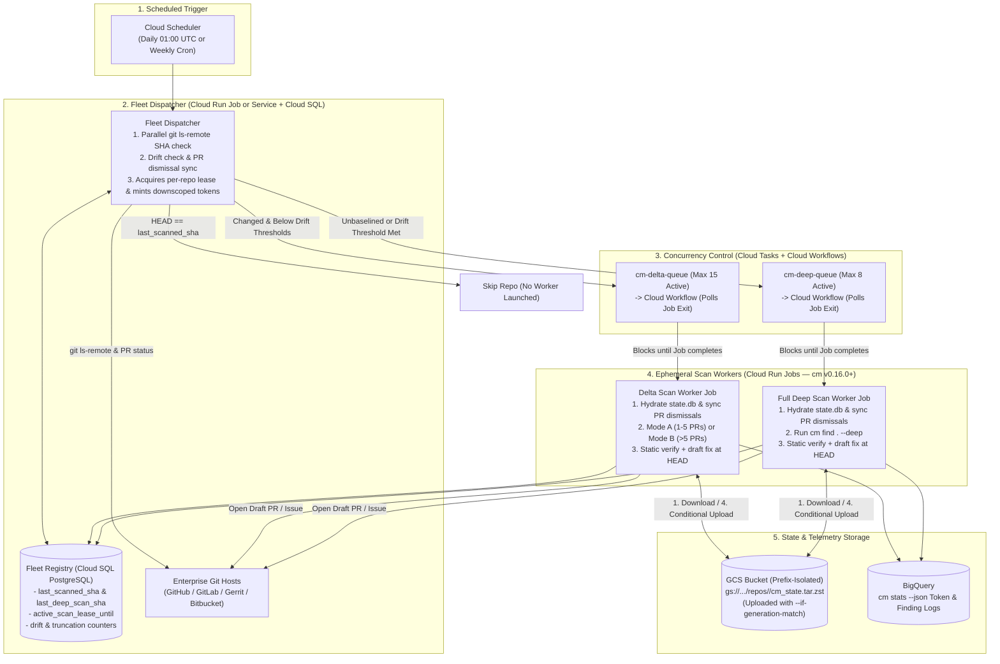
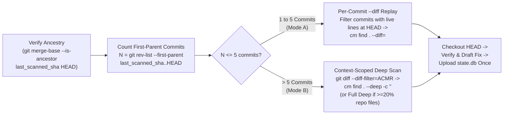
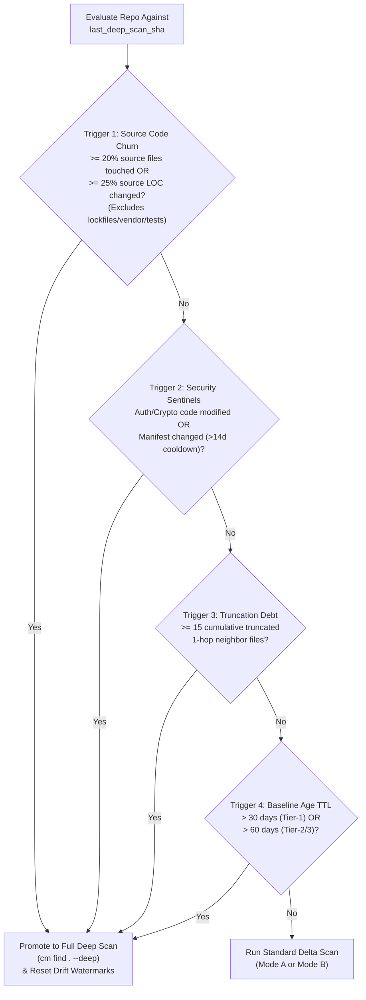

# Continuous Multi-Repository Security Monitoring with CodeMender

**Author:** Kui Luo (`kuiluo@`)  
**Status:** Draft  
**Target Audience:** Security FDEs, Customer AppSec Architects, CodeMender Core Engineers  
**AI Usage Disclosure (`go/recommendations-for-ai-assisted-documents`):** AI was used to structure tables, format Mermaid diagrams, and edit prose. All architectural decisions, CLI flags (`cm` v0.16.0+), failure modes, and cost models were verified against internal CodeMender benchmarks and GCP service limits.

---

## 1. Context & Problem Statement

Enterprise security teams adopting **CodeMender (`cm` v0.16.0+)** want to scan **100 to 500 repositories** on a daily or weekly schedule from a central Google Cloud project, without modifying each repository's CI/CD pipeline.

CodeMender provides two primary scan modes for scheduled fleet monitoring: `cm find . --deep` (the default mode in `v0.16.0+` when called without a mode flag) for full-repository concurrent audits and `cm find . --diff` for pull-request deltas. However, running `cm` across a 100+ repository fleet on a recurring schedule exposes four concrete technical gaps:

1. **Unnecessary Full-Repo Scans on Unchanged Code**: In a typical 100-repository enterprise portfolio (combining active microservices with slower-moving libraries, infrastructure repos, and internal tools), we model that only ~20%–30% of repositories receive commits on a given workday, and an average active day (2–3 merged PRs) modifies 4–6 files (<2% of a 250-file repository). Running `cm find . --deep` (~1.2M tokens/repo) across all 100 repositories every day would spend ~3,600M tokens/month (~$2,520/month in LLM costs), ~90% of which re-audits code that has not changed since yesterday.
2. **The `cm --diff` Single-PR Cap (`--diff-max-neighbors=10`)**: `cm find . --diff=<base_ref>` was built to audit a single pull request. It resolves 1-hop caller/callee neighbor files for modified symbols and caps inspected neighbors at 10 files per run. If a busy repository merges 10 PRs in a day (or 30 PRs in a week), running a single `cm find . --diff=<last_scanned_sha>` across the cumulative commit range hits the 10-file neighbor cap (`WARNING: Impact expansion truncated`), leaving caller/callee files uninspected and flattening commits from multiple authors into one unattributed diff.
3. **Ephemeral Worker State Loss & Concurrent Write Races**: CodeMender stores finding lifecycles (`OPEN`, `FIXED`, `DISMISSED`, `REOPENED`) in a local SQLite file (`$CM_HOME/state.db`) keyed by a UUID in `<repo_root>/.cm_project`. In stateless container workers, throwing away `state.db` after each run causes dismissed false positives to reappear every day. Conversely, if two jobs for the same repository overlap (e.g., a delayed retry alongside a new daily run), concurrent uploads to Cloud Storage will overwrite each other's SQLite database.
4. **Gradual Drift from the Last Full Baseline**: Relying only on 1-hop incremental delta scans forever misses vulnerabilities introduced by 3+ hop dataflow changes, global middleware edits, or accumulated neighbor truncations.

### Summary of Proposed Design

To solve these four gaps without over-engineering the control plane, this document proposes:
* **Pre-Flight Remote SHA Check**: Before cloning or starting a worker container, a lightweight dispatcher runs `git ls-remote` against each repository and compares the remote `HEAD` SHA with `last_scanned_sha`, skipping unchanged repositories immediately.
* **Two-Mode Delta Scanning (Cutoff at 5 Merged PRs)**:
  * *Mode A (1–5 Merged PRs)*: Replays `cm find . --diff=<parent_sha>` per merged PR along the first-parent commit graph (skipping commits whose touched lines were completely overwritten by a later commit in the same window). This keeps each `--diff` call within the 1-hop neighbor limit and maps findings to the specific PR that introduced them.
  * *Mode B (>5 Merged PRs)*: Extracts currently existing modified source files (`git diff --name-only --diff-filter=ACMR`) and runs a single **Context-Scoped Deep Scan** (`cm find . --deep --context <bulleted_file_list>`). Because `cm find <path>` accepts only a single `<path>` argument, passing the repo root `.` alongside a markdown-bulleted file list in `--context` triggers CodeMender's native `scopeToProvidedFiles` filter—auditing only the modified files plus their 1-hop dependency closure while avoiding the latency of replaying many individual commits.
* **Four-Trigger Drift Promotion to Full `--deep` Scan**: Promotes a repository from a delta scan to a full `cm find . --deep` re-baseline when: (1) $\ge 20\%$ of first-party source files or $\ge 25\%$ of source LOC have changed since the last deep scan (excluding lockfiles, vendor directories, and tests), (2) first-party auth/crypto/middleware paths change (or build manifests change after a 14-day cooldown), (3) $\ge 15$ candidate neighbor files have been truncated across delta runs, or (4) the baseline age exceeds 30 days (Tier-1) or 60 days (Tier-2/3).
* **Serialized Per-Repo State Persistence**: Stores each repository's `state.db` and `.cm_project` in a prefix-isolated GCS object (`gs://.../repos/<repo_id>/cm_state.tar.zst`) protected by a per-repository database lease and GCS generation preconditions (`--if-generation-match`).

---

## 2. Background: CodeMender (`cm` v0.16.0+) Capabilities & Constraints

This section summarizes how CodeMender (`cm` v0.16.0+) executes scans under the hood, and why its internal behavior dictates our fleet architecture.

CodeMender runs a local CLI thin worker that discovers source files, manages local SQLite state (`$CM_HOME/state.db`), and dispatches sessions to the Gemini Enterprise Agent Platform (`gemini-3.8-flash` default; `gemini-3.8-flash-cyber`, `gemini-4-argon`, or `gemini-4-argon-cyber-permissive` for deep taint verification).

| Scan Command | Scope Audited | Default Workers | Typical Latency & Token Usage (250-file repo) | Key Operational Constraint |
| :--- | :--- | :--- | :--- | :--- |
| **`cm find . --diff=<ref>`** | Modified hunks + 1-hop caller/callee files (capped at `--diff-max-neighbors=10`, configurable to `15`) | 4 workers | **1–2 mins**<br/>~30k tokens / PR | Truncates neighbor inspection when a diff spans many files; attributes findings to the entire diff range rather than individual commits. |
| **`cm find . --deep -c "<files>"`** | Provided extant files extracted from `--context` (`parseContextCandidates`) + immediate 1-hop dependency closure (`resolveProvidedFileNeighbors`) | 8 workers | **2–5 mins**<br/>~150k–180k tokens (for 10–15 files) | `cm find <path>` accepts at most 1 positional argument (`cobra.MaximumNArgs(1)`). Multi-file scoping requires passing `.` as `<path>` and formatting extant (`--diff-filter=ACMR`) file paths as `- <path>` bullets or `` `<path>` `` in `--context`. |
| **`cm find . --deep`** *(default)* | All tracked source files in 2-file micro-batches after Stage 1 Tree-Sitter AST pruning of safe literal sinks | 8 workers | **10–20 mins**<br/>~1.2M tokens | High token cost if run daily on unchanged code; achieves 86%–96% recall and >97% precision (<2% FPR) on OWASP benchmarks. |

### Nuance on `cm find --deep` vs. `cm verify` and `cm fix`
Internal field testing established two important behaviors that shape Section 7 of this design:
1. **`cm find --deep` already performs localized AST pruning and batch verification**: Stage 1 Tree-Sitter AST pruning removes benign literal sinks at zero token cost, and Stage 2 verifies dataflow across 2-file micro-batches, achieving **<2% false positive rate** without needing a live build container.
2. **`cm verify` and `cm fix` have sandbox constraints**: Full `cm verify` attempts dynamic exploit verification inside a container sandbox, which requires a working per-repository build/test environment (`build.command`) and shows mixed reliability when repositories lack self-contained build configs. Therefore, this architecture relies primarily on `cm find --deep`'s built-in AST/micro-batch verification for discovery, uses static verification (`cm verify --skip-exploit-verification --no-reset`) only as a secondary filter on `CRITICAL`/`HIGH` findings, and defaults to non-sandboxed patch generation (`cm --sandbox=false fix <id> --yes` attached to a Draft PR or issue) unless a repository explicitly provides a sandbox build configuration.

---

## 3. Goals & Non-Goals

### 3.1 Goals
* **G1 — Daily/Weekly Monitoring for 100–500 Repositories**: Complete a daily fleet sweep of 100 repositories in **< 45 minutes** wall-clock time without requiring per-repository CI/CD workflow edits.
* **G2 — Preserve 1-Hop Neighbor Coverage & Commit Attribution**: Ensure daily and weekly delta scans do not silently drop 1-hop caller/callee files when multiple PRs merge between scans, and identify which commit introduced each net-new finding.
* **G3 — Automated Re-Baselining on Meaningful Drift**: Promote repositories to a full `--deep` scan when cumulative code churn, auth/crypto edits, or neighbor truncation makes incremental diffs stale, while ignoring noise from lockfile or Dependabot bumps.
* **G4 — Safe State Continuity Across Ephemeral Runs**: Persist finding statuses (`OPEN`, `FIXED`, `DISMISSED`, `REOPENED`) in GCS so dismissed false positives stay muted and overlapping jobs cannot corrupt `state.db`.
* **G5 — Low Steady-State Cost & Repeatable Deployment**: Keep steady-state monthly cost under **$150/month for 100 repositories** and package the infrastructure in a single Terraform module.

### 3.2 Non-Goals
* **NG1 — Synchronous CI/CD Pull Request Gating**: Blocking developer PR merges inline in CI/CD is out of scope; this system runs out-of-band on a schedule.
* **NG2 — Third-Party SAST / Wiz Report Ingestion**: Importing external vulnerability reports (`cm report import`) is tracked in a separate investigation.
* **NG3 — Custom Build Containers per Repository**: We do not require application teams to build or maintain Docker build environments to onboard their repositories.

---

## 4. System Architecture & Alternatives Considered

This section presents the end-to-end Google Cloud architecture, explains why each component exists, and compares this setup against four simpler alternatives we evaluated and rejected.



### 4.1 Component Responsibilities

1. **Cloud Scheduler**: Triggers the Fleet Dispatcher on the configured schedule (e.g., `0 1 * * *` daily).
2. **Fleet Dispatcher**:
   * Queries the `repo_registry` table in Cloud SQL and runs parallel `git ls-remote <repo_url> HEAD` checks (< 5 seconds for 200 repositories).
   * If `remote_head_sha == last_scanned_sha` (and the repository has not exceeded its 30/60-day baseline TTL), the repository is skipped immediately.
   * If `remote_head_sha != last_scanned_sha`, the Dispatcher checks that no active scan lease exists (`active_scan_lease_until < now()`), evaluates the **Drift Triggers** (Section 6), mints a **prefix-downscoped GCS token** restricted to `gs://<bucket>/repos/<repo_id>/*`, and enqueues an execution task.
3. **Cloud Tasks + Cloud Workflows Concurrency Layer**:
   * **The Cloud Run Jobs API Quirk**: Calling the Cloud Run Jobs API (`POST .../jobs/<job>:run`) directly from a Cloud Tasks HTTP target returns `200 OK` in ~150ms as soon as the job is *created*, not when the container finishes. If Cloud Tasks called Cloud Run Jobs directly with `max_concurrent_dispatches = 15`, Cloud Tasks would consider each task complete in 150ms and launch all 100+ repository jobs within 2 seconds, exhausting Vertex AI quota. Conversely, running scans inside a synchronous Cloud Run *Service* hits Cloud Tasks' 30-minute HTTP timeout on large `--deep` scans.
   * **How Cloud Workflows Solves This**: Cloud Tasks dispatches to a lightweight **Cloud Workflow (`cm-job-runner`)** with `max_concurrent_dispatches = 15` (delta) and `8` (deep). The workflow calls `googleapis.run.v1.namespaces.jobs.run`, which polls the long-running job execution (up to 60+ minutes) and only returns `200 OK` to Cloud Tasks when the container exits.
4. **Ephemeral Scan Workers (Cloud Run Jobs)**:
   * Each job handles a single repository from start to finish: runs `CM_TASK_AGENT_ID=<id> cm health --strict --json` as a zero-cost pre-flight check, hydrates `state.db` from GCS, syncs PR dismissals, runs discovery (`cm find`), runs verification/patch synthesis on net-new `CRITICAL`/`HIGH` findings, and uploads the updated `state.db` back to GCS using `--if-generation-match`.

### 4.2 Alternatives Considered

| Alternative Architecture | Pros | Cons / Why Rejected |
| :--- | :--- | :--- |
| **Alt 1: Scheduled GitHub Actions / GitLab CI Cron per Repository** | Zero GCP orchestration infrastructure to deploy; runs natively inside the customer's VCS host. | **Violates core requirement**: Requires committing and maintaining workflow YAML files across 100–500 separate repositories, distributing GCP/Vertex credentials to every repo, and provides no cross-repo concurrency throttling against shared Vertex AI quotas. |
| **Alt 2: Single Monolithic Cloud Run Job Looping Sequentially Over All Repos** | Very simple infrastructure (only 1 Cloud Run Job + GCS bucket; no Cloud Tasks, Workflows, or Cloud SQL). | **Too slow and brittle at 100+ repos**: Scanning 30 changed repos + 5 deep-scan repos takes ~165 compute-minutes. A single sequential job takes nearly 3 hours, and one container crash or OOM kills the entire fleet run. *(Note: For small fleets of <15 repos, this simpler option is viable.)* |
| **Alt 3: Cloud Workflows Only (Using `parallel` Steps Instead of Cloud Tasks)** | Removes Cloud Tasks (1 fewer GCP service). | Cloud Workflows' native `parallel` block has strict quotas on concurrent branches (max 20) and total workflow execution memory/history steps when polling 100+ long-running operations in a single workflow execution. Using Cloud Tasks per repository provides independent per-repo retry backoffs, dead-letter queuing, and task deduplication. |
| **Alt 4: Store All State in Cloud SQL Instead of Per-Repo SQLite in GCS** | Eliminates GCS `cm_state.tar.zst` hydration and `--if-generation-match` locking. | **Incompatible with `cm` v0.16.0+ binary**: The `cm` CLI reads and writes a local SQLite file (`$CM_HOME/state.db`) directly during `find`, `verify`, `fix`, and `report`. Modifying `cm` to use a remote PostgreSQL backend requires upstream CLI changes. |

---

## 5. Daily & Weekly Delta Scans: Handling Multi-PR Windows

This section explains how the Delta Scan Worker scans repositories that have merged multiple pull requests since `last_scanned_sha` without hitting `cm --diff`'s neighbor cap or wasting tokens on overwritten commits.

### 5.1 Why Naive Cumulative `cm find --diff` Fails on Multi-PR Windows

Running a single `cm find . --diff=<last_scanned_sha>` across a full day or week of commits causes three concrete problems:
1. **1-Hop Neighbor Truncation (`--diff-max-neighbors=10`)**: `cm find --diff` extracts modified symbols and looks up 1-hop caller/callee files across the repository, stopping at 10 neighbor files (configurable up to 15). While a single PR typically touches 2–3 files and 4–6 neighbors, a cumulative diff of 10 PRs easily touches 20+ files and 35+ neighbors, dropping over half of the impacted caller/callee files.
2. **Ambiguous Commit Attribution**: When `cm find --diff` flags a vulnerability in an untouched 1-hop neighbor file (because a caller or sanitizer changed in the diff), a cumulative diff across 10 PRs cannot identify which PR broke the invariant without manual investigation.
3. **64 KB Inline File Preview Limit**: Large cumulative diffs exceed the CLI's inline preview buffer, forcing additional tool calls and increasing token usage.

### 5.2 Two-Mode Delta Engine & The 5-PR Crossover Point

Why not simply replay `cm find . --diff` on every single commit regardless of how many PRs merged?
* **The Overlap & Latency Trade-off**: A single-PR `--diff` scan takes ~1.5 minutes and ~30k tokens. A Context-Scoped Deep Scan (`cm find . --deep --context <files>`) on 10–15 modified files takes ~3.5 minutes and ~150k–180k tokens.
* **Crossover Math**: Once a repository merges **more than 5 PRs** in a single window ($5 \times 30\text{k} = 150\text{k tokens}$, ~7.5 minutes), individual PRs frequently modify overlapping files or shared neighbors—meaning per-PR replay scans the same files multiple times and costs more tokens and wall-clock time than a single coalesced Context-Scoped Deep Scan.

Therefore, after cloning the repository (`git clone --shallow-since=<last_deep_scan_date>`) and verifying commit ancestry (`git merge-base --is-ancestor <last_scanned_sha> HEAD`), the worker counts first-parent commits (`N = git rev-list --first-parent --count <last_scanned_sha>..HEAD`) and branches at **$N = 5$**:



#### Mode A: Per-Commit `--diff` Replay (1 to 5 First-Parent Commits)
1. **Filtering Out Completely Overwritten Commits**: Before checking out an intermediate commit $C_i$, the worker checks whether any lines added or modified by $C_i$ still survive at `HEAD` by running `git diff -U0 <C_{i-1}> <C_i>` and verifying via `git blame -L <start>,<end> HEAD -- <file>` that at least one line in the hunk is still attributed to $C_i$ (or if $C_i$ only deleted code, that the surrounding function still exists at `HEAD`). If a commit was completely reverted or overwritten by a later commit in the same day's window, $C_i$ is skipped.
2. **Per-Commit Scan**: For each surviving commit $C_i$ (with parent $C_{i-1}$), the worker checks out $C_i$ and runs:
   ```bash
   cm find . --diff=${C_prev} --diff-depth=1 --diff-max-neighbors=15 --diff-workers=4 --yes
   ```
3. **Checkpoint Persistence & Deferred Verification at `HEAD`**:
   * Because all replay steps share the local `$CM_HOME/state.db`, findings are deduplicated across $C_1 \dots C_k$, and the worker records which commit $C_i$ first introduced each finding fingerprint.
   * Verification (`cm verify`) and patch synthesis (`cm fix`) are **not** run on intermediate checkouts; once discovery finishes across $C_1 \dots C_k$, the worker checks out `HEAD` and verifies only findings that remain `OPEN` at `HEAD`.

#### Mode B: Coalesced Context-Scoped Deep Scan (>5 First-Parent Commits)
1. **Extant Source File Extraction (`--diff-filter=ACMR`)**: The worker lists all source files added, copied, modified, or renamed in `<last_scanned_sha>..HEAD` while excluding deleted (`D`) files and non-code lockfiles:
   ```bash
   CHANGED_FILES=$(git diff --name-only --diff-filter=ACMR <last_scanned_sha>..HEAD -- \
     . ':!*.lock' ':!package-lock.json' ':!go.sum' ':!vendor/' | sed 's/^/- /')
   ```
2. **20% Churn Promotion Check & Native `--context` File Scoping**:
   * **Why Not `cm find <file1> <file2> ... --deep`?**: In `cm` v0.16.0+, `cm find <path>` enforces `cobra.MaximumNArgs(1)` (`Error: accepts 1 arg(s), received 2`). Instead, when `<path>` is the repository root `.` and `-c` / `--context` contains repo-relative file paths formatted as markdown bullets (`- path/to/file.py`), backticks (`` `path/to/file.py` ``), or `File: path/to/file.py`, CodeMender's `discoverAndScopeFindFiles` $\rightarrow$ `scopeToProvidedFiles` (`parseContextCandidates`) automatically extracts those file paths, resolves their 1-hop impacted neighbors (`resolveProvidedFileNeighbors`), logs `🎯 Scoping scan to N provided file(s) and their immediate dependency closure:`, and runs the concurrent `--deep` scan **only** on those scoped files while preserving `.` as the workspace root.
   * If the modified source file count is $\ge 20\%$ of total repository source files, the worker promotes the scan to an unscoped full `cm find . --deep` (and resets drift counters). Otherwise, it runs:
     ```bash
     cm find . --deep --deep-workers=8 --yes --format=json \
       --context "$(printf 'Audit modified files:\n%s' "$CHANGED_FILES")"
     ```
3. **Post-Scan Commit Attribution**: For any net-new finding discovered in Mode B:
   * If the vulnerable file/lines were modified in `<last_scanned_sha>..HEAD`, the worker runs `git log -n 1 -L <start_line>,<end_line>:<file_path> <last_scanned_sha>..HEAD` to identify the exact commit and author.
   * If the finding is in an untouched 1-hop neighbor file, the worker matches the called symbol against the commits in `<last_scanned_sha>..HEAD` that modified that symbol's definition or callsite; if multiple commits touched the symbol, attribution lists the candidate commits in the range.

### 5.3 Concrete Walkthrough Example: `payments-service` (240 Source Files)

To illustrate how the Dispatcher, Mode A, and Drift Triggers interact on a real repository:
* **Initial State (Monday 01:00 UTC)**: `payments-service` has 240 Go source files. `last_scanned_sha = a1b2c3d`, `last_deep_scan_sha = a000001` (10 days ago), `cumulative_churn_pct = 4.2%`, `truncated_neighbors_since_deep = 2`.
* **Day 1 (Tuesday 01:00 UTC — 0 PRs Merged)**:
  * Dispatcher runs `git ls-remote` -> remote `HEAD` is still `a1b2c3d`.
  * **Action**: Dispatcher skips `payments-service` in 40ms. Zero containers launched, zero tokens spent.
* **Day 2 (Wednesday 01:00 UTC — 3 PRs Merged: `c111`, `c222`, `c333`)**:
  * PR #101 (`c111`): Modifies `pkg/checkout/cart.go` (adds a query parameter).
  * PR #102 (`c222`): Modifies `pkg/checkout/discount.go` (buggy regex), which is completely rewritten 2 hours later by PR #103 (`c333`) in `pkg/checkout/discount.go`.
  * **Action**: Dispatcher sees `HEAD = c333 != a1b2c3d`. Drift check shows 2 source files changed since `last_deep_scan_sha` ($4.2\% + 0.8\% = 5.0\% < 20\%$), no auth/crypto sentinel files touched. Enqueues to `cm-delta-queue`.
  * **Worker Execution (Mode A, $N = 3 \le 5$)**:
    1. Checks `c111`: lines in `cart.go` are live at `HEAD` (`c333`). Runs `cm find . --diff=a1b2c3d` at `c111` (audits `cart.go` + 4 neighbor files = 28k tokens). Finds 1 `HIGH` SQLi in untouched neighbor `pkg/db/orders.go` where `cart.go`'s unsanitized parameter flows into a query. Attributed to PR #101 (`c111`).
    2. Checks `c222`: `git blame` at `HEAD` (`c333`) shows every line modified by `c222` in `discount.go` was overwritten by `c333`. **Skips `c222`** (saves 30k tokens).
    3. Checks `c333`: Runs `cm find . --diff=c222` at `c333` (audits `discount.go` + 3 neighbors = 24k tokens). 0 findings.
    4. Checks out `HEAD` (`c333`), runs static verification and `cm --sandbox=false fix <id> --yes` on the SQLi finding in `pkg/db/orders.go`, opens a Draft PR assigned to PR #101's author, uploads `cm_state.tar.zst`, and updates `last_scanned_sha = c333`.
* **Day 3 (Thursday 01:00 UTC — 1 PR Merged Touching `pkg/auth/jwt_middleware.go`)**:
  * Dispatcher detects `pkg/auth/jwt_middleware.go` matches the **Security Sentinel** glob (`**/auth/**`).
  * **Action**: Promotes `payments-service` to `cm-deep-queue` (`cm find . --deep`), re-audits all 240 files, and resets `last_deep_scan_sha` to the new `HEAD`.

---

## 6. Repository Drift Detection: When to Re-Baseline with `--deep`

This section defines the four rules that promote a repository from a daily/weekly delta scan to a full `cm find . --deep` scan, and explains how we prevent dependency update bots from triggering unnecessary deep scans.



### 6.1 The Four Drift Triggers & Threshold Rationale

Why these specific thresholds (20% file churn, 14-day manifest cooldown, 15 truncated neighbors, 30/60-day TTL)?
* **Cost/Coverage Balance**: As shown in Section 2, a Context-Scoped Deep Scan (`cm find . --deep --context <files>`) inspects each changed file plus its 1-hop dependency closure (~2–3 additional files per changed file). Once **20% of a repository's source files** have changed, their 1-hop dependency closures cover 60%–80% of the repository—meaning incremental scans cost nearly as much as a full `cm find . --deep` scan without resetting multi-hop drift.

1. **Trigger 1 — First-Party Source Code Churn ($\ge 20\%$ Source Files or $\ge 25\%$ Source LOC)**:
   * Compares `HEAD` against `last_deep_scan_sha` while excluding lockfiles, vendor directories, generated code, and unit tests:
     ```bash
     git diff --shortstat <last_deep_scan_sha>..HEAD -- . ':!*.lock' ':!package-lock.json' ':!go.sum' ':!vendor/' ':!*_test.*'
     ```
   * Excluding lockfiles and tests is critical: a routine `npm update` can modify 25,000 lines in `package-lock.json` without changing a single line of first-party source code.
2. **Trigger 2 — Security Sentinel Code Changes & Cooldown-Gated Manifest Updates**:
   * **First-Party Security Code (Immediate `--deep`)**: Edits to authentication, authorization, cryptography, or global middleware paths (`**/auth/**`, `**/security/**`, `**/crypto/**`, `**/middleware/**`) immediately trigger a full `--deep` scan because changes to a shared sanitizer or auth decorator can affect route handlers 3+ hops away.
   * **Dependency Manifests (14-Day Cooldown Gate)**: Edits to `go.mod`, `package.json`, `requirements.txt`, `pom.xml`, or `build.gradle` promote the repository to `--deep` **only if `now() - last_deep_scan_at >= 14 days`**. Without this cooldown, repositories using Dependabot or Renovate would trigger a full repository deep scan several times a week.
3. **Trigger 3 — Accumulated Neighbor Truncation Debt ($\ge 15$ Skipped Files)**:
   * Whenever a `--diff` run logs `WARNING: Impact expansion truncated (X candidate files identified, capped at Y)`, the worker adds $(X - Y)$ to `truncated_neighbors_since_deep` in Cloud SQL. Once $\ge 15$ candidate neighbor files have gone uninspected since the last baseline (or $>50\%$ of candidates in a single run), the repository is promoted to `--deep`.
4. **Trigger 4 — Maximum Baseline Age TTL (30 Days Tier-1 / 60 Days Tier-2 & Tier-3)**:
   * Ensures every active repository gets a periodic full-repo refresh (and handles cases where both `last_scanned_sha` and `last_deep_scan_sha` were overwritten by a force-push).
   * **Staggered Pacing (`crc32(repo_id)`)**: To prevent 50 repositories onboarded on the same day from all hitting their 30-day TTL on the same morning, TTL promotions are bucketed by `crc32(repo_id) % 30` and capped at **10% of the fleet per day**.

---

## 7. State Persistence, Verification & Failure Handling

This section details how workers persist SQLite state in GCS without race conditions, how findings are verified and delivered to developers, and how the system recovers from partial failures.

### 7.1 Per-Repository State Locking & GCS Hydration

CodeMender tracks finding fingerprints (`SHA256(file_path + vuln_type + normalized_snippet)[:16]`) inside `$CM_HOME/state.db`, linked to the repository via `<repo_root>/.cm_project`. To persist this state safely across stateless Cloud Run Jobs:

1. **Database Lease & GCS Preconditions (Preventing Concurrent Writers)**:
   * Before enqueuing a job, the Dispatcher sets `active_scan_lease_until = now() + 90 minutes` on the repository's row in Cloud SQL (`UPDATE repo_registry SET active_scan_lease_until = ... WHERE repo_id = $1 AND (active_scan_lease_until IS NULL OR active_scan_lease_until < now())`).
   * When the worker downloads `gs://<bucket>/repos/<repo_id>/cm_state.tar.zst`, it records the GCS object's `generation` number (`G`).
   * At the end of the job, the worker uploads the updated archive using `gcloud storage cp ... --if-generation-match=G`. If a zombie job from an earlier run somehow completed while the new job was running, the stale upload fails cleanly with `412 Precondition Failed` instead of silently overwriting newer state.
2. **Closed-Loop PR Dismissal Sync**:
   * Before running `cm find`, the worker checks the VCS API for any previously opened CodeMender PRs or issues on this repository that were closed with a `false-positive` or `wontfix` label since `last_scanned_at`.
   * For each rejected PR, the worker updates the hydrated `$CM_HOME/state.db` (`UPDATE findings SET status='DISMISSED', dismiss_reason='Closed via PR review', updated_at=? WHERE finding_id=?`), preventing CodeMender from re-opening the same finding on future runs.
3. **Mid-Run Failure & Partial Progress Recovery**:
   * In Mode A (per-commit replay), if the container fails on commit 3 of 4 (e.g., due to a transient Vertex API 503 error), the worker's `EXIT` trap uploads the intermediate `cm_state.tar.zst` to GCS and advances `last_scanned_sha` to commit 2 (`C_2`). On retry, the worker resumes at commit 3 rather than re-scanning commits 1 and 2.

### 7.2 Verification Strategy & Draft Patch Delivery

As noted in Section 2, `cm find --deep` already filters out benign literal sinks with >97% precision, while dynamic sandbox verification (`cm verify`) requires a working build container per repository. We therefore use a two-tier remediation pipeline for net-new `CRITICAL` and `HIGH` findings at `HEAD`:

* **Default Path (No Per-Repo Build Container Required)**:
  1. Runs `cm verify <finding_id> --skip-exploit-verification --no-reset --model=gemini-3.8-flash-cyber --yes` to perform multi-turn static taint and reachability verification. Findings determined to be unreachable are marked `DISMISSED` in `state.db`.
  2. For confirmed findings, runs `cm --sandbox=false fix <finding_id> --yes` to generate a unified diff patch and opens a **Draft Pull Request** (or attaches the patch to a Security Issue, configurable per repo) assigned to the attributed commit author. Opening the PR as a **Draft** prevents uncompiled patches from triggering noisy CI failure alerts while still giving the author a ready-to-apply diff.
* **Opt-In Sandbox Path (For Tier-1 Repos with Build Containers)**:
  * If a repository defines a custom container and `build.command` in `.cm/config.yaml`, the worker runs full dynamic `cm verify <finding_id> --yes` and `cm --sandbox=true fix <finding_id> --yes`, opening a **Ready-for-Review PR** only after the patch compiles and passes unit tests in the sandbox.

---

## 8. Customer Pipeline Controls, Reporting & Visualization

This section summarizes how customer security teams and developers control the scanning pipeline day-to-day, and how token telemetry and vulnerability findings are visualized and reported.

### 8.1 Pipeline Control Surfaces

Customer teams manage the pipeline through four control surfaces without redeploying containers:

| Control Surface | Target Persona | What It Controls & How It Works |
| :--- | :--- | :--- |
| **1. Declarative Fleet Manifest (`repos.yaml`)** | AppSec Engineers | Stored in GCS or synced via GitOps; read by the Dispatcher on every run:<br/>• **Onboarding / Pausing**: Toggle `enabled: true \| false` or add repositories.<br/>• **Risk Tier & Schedule**: Set `risk_tier` (`tier-1` = 30d TTL, `tier-2/3` = 60d TTL) and `schedule` (`daily` \| `weekly`).<br/>• **Remediation Delivery Mode**: Set `delivery_mode` (`draft_pr` \| `issue_only` \| `report_only` for silent monitoring without PRs).<br/>• **Attribution & Custom Sentinels**: Set `team_id` (passed to `cm --team-id`) and custom `sentinel_globs` (e.g., `["pkg/pci/**"]`). |
| **2. On-Demand Admin API & Queue Controls** | SecOps / On-Call | IAM-authenticated HTTP endpoints on the Fleet Dispatcher and standard `gcloud` CLI controls:<br/>• **Force Immediate Scan**: `POST /v1/scan` (`{"repo_id": "...", "scan_mode": "deep"}`) bypasses the SHA check to scan a repo immediately (e.g., pre-release audit).<br/>• **Emergency Kill-Switch**: `gcloud tasks queues pause cm-delta-queue` / `cm-deep-queue` halts new job dispatches immediately. |
| **3. In-Repo PR & Issue Labels** | Application Developers | Developers manage findings directly in GitHub/GitLab without needing GCP access:<br/>• **Apply Fix**: Review and merge the CodeMender **Draft PR** (`OPEN` $\rightarrow$ `FIXED` on next scan).<br/>• **Mute False Positives**: Close a Draft PR or issue with a `false-positive` or `wontfix` label; the next worker run marks the finding `DISMISSED` in `state.db`. |
| **4. Terraform Guardrails (`customer.tfvars`)** | Cloud Platform Admins | Controls global worker concurrency (`max_concurrent_delta = 15`, `max_concurrent_deep = 8`), cron schedules, global drift thresholds, and GCP budget alerts. |

### 8.2 Reporting & Visualization Channels

At the end of every scan job, the worker executes two local CLI commands against `$CM_HOME` at **zero extra LLM token cost**:
* **`cm stats --json --since=24h`**: Extracts per-session token usage (`INPUT`, `OUTPUT`, `CACHED`, `THOUGHT`, `TOOL_CALLS`, `TOTAL`, `CACHE_HIT%`) broken down by command (`find`, `verify`, `fix`) and `--team-id`.
* **`cm report --patches --format=<json|sarif|html>`**: Exports findings (`OPEN`, `FIXED`, `DISMISSED`, `REOPENED`), severity (`CRITICAL`, `HIGH`, `MEDIUM`, `LOW`), file/line locations, and generated unified diff patches.

These outputs feed **three reporting and visualization channels**:

| Reporting Channel | Target Audience | Visualization & Delivery Mechanism |
| :--- | :--- | :--- |
| **Channel 1: Looker Studio / BigQuery Dashboard** | AppSec & FinOps Leadership | Backed by partitioned BigQuery tables (`scan_telemetry`, `finding_events`) and Cloud SQL (`repo_registry`):<br/>• **Fleet Coverage & Drift Health**: Daily counts of Skipped (`0` tokens) vs. Mode A/B Delta vs. Drift `--deep` runs, plus repos approaching the 20% churn or 30d TTL thresholds.<br/>• **Vulnerability Posture & MTTR**: Active `OPEN`, `FIXED`, `DISMISSED`, and `REOPENED` findings by `risk_tier` and CWE category, Mean Time to Remediate, and false-positive dismissal rate.<br/>• **FinOps Token Attribution**: Daily/monthly token spend and cache hit rates grouped by `--team-id`, repository, and scan phase (`find` vs. `verify` vs. `fix`). |
| **Channel 2: Native GitHub / GitLab Security Tab & Draft PRs** | Application Developers | • **Inline Code Annotations (`SARIF 2.1.0`)**: Worker uploads `cm report --format=sarif` to the GitHub Code Scanning / GitLab Security API so findings appear directly on the vulnerable lines in the repo's **Security** tab.<br/>• **Draft Remediation PRs**: Verified `CRITICAL`/`HIGH` findings open a Draft PR containing root-cause analysis and the `cm fix` unified diff patch assigned to the introducing commit author. |
| **Channel 3: Self-Contained HTML Reports in GCS** | SecOps & Compliance Auditors | • **Interactive Browser Reports**: Whenever a scan records or updates findings, the worker runs `cm report --format=html --patches --artifacts` and uploads the standalone HTML report to `gs://<bucket>/reports/<repo_id>/<scan_date>/report.html`.<br/>• Reviewers can open the authenticated GCS link in a browser to inspect full taint paths, patches, and verification artifacts without CLI setup. |

---

## 9. Cost Model & Sensitivity Analysis (100–250 Repositories)

This section provides the estimated one-time onboarding cost and recurring monthly cost for 100 and 250 repositories, followed by a sensitivity table showing how costs change if a customer's fleet is much more active than our baseline model.

### 9.1 Baseline Fleet Assumptions & Token Formulas

All cost estimates below are calculated from three explicit inputs:

1. **Empirical Token Usage per Operation** (from `cm stats --json` telemetry and [CodeMender Deep Find Benchmarks](https://docs.google.com/spreadsheets/d/12fNHoAU_rLDY7whWeBzMjNaFjHst9ldxg938Al6pK7w/edit?resourcekey=0-dmbHjLjY4XFcrdTLexG-ZA&gid=0#gid=0), modeled on a 250-source-file / 50k-LOC repository):
   * **Full Deep Scan (`cm find . --deep`, 8 workers)**: ~125 2-file micro-batches $\times$ 9.6k tokens/batch ($\sim 8.5\text{k}$ input + $\sim 1.1\text{k}$ output/thinking) = **~1.2M tokens/repo** ($88\%$ input, $12\%$ output).
   * **Single-PR Diff Scan (`cm find . --diff`, 4 workers)**: 2–3 modified files + 4–6 1-hop neighbors (~3 micro-batches) = **~30k tokens/PR** (or **~75k tokens/day** for an active repo merging 2.5 PRs/day).
   * **File-Scoped Deep Scan (Mode B)**: ~12–15 modified files + 1-hop dependency closure (~18 micro-batches) = **~180k tokens/run**.
   * **Static Verify + Patch Generation (`cm verify` + `cm fix`)**: **~50k tokens** per net-new `CRITICAL`/`HIGH` finding.
2. **Vertex AI Gemini Flash Pricing (`gemini-3.8-flash` / `gemini-3.8-flash-cyber`)**:
   * ~$0.40 per 1M input tokens; ~$2.90 per 1M output/thinking tokens.
   * At an 88% input / 12% output split, the blended rate is:
     $$\text{Rate}_{\text{blended}} = (0.88 \times \$0.40) + (0.12 \times \$2.90) = \mathbf{\$0.70\text{ per 1M total tokens}}$$
3. **GCP Serverless Infrastructure Rates (`us-central1`)**:
   * **Cloud Run Jobs (`2 vCPU, 4 GiB RAM`)**: ~$0.0035 per container-minute (~$10/month for ~2,880 container-minutes of daily delta + drift runs across 100 repos).
   * **Cloud SQL PostgreSQL (`db-g1-small`, 1 shared vCPU, 10 GB SSD)**: ~$30/month.
   * **Cloud Workflows, Cloud Tasks, GCS (<5 GB), Scheduler & BigQuery**: ~$5/month.
   * *(Optional) Cloud NAT + Static Egress IP*: +$38/month only if the customer's self-hosted Git server requires IP allowlisting.

### 9.2 Monthly Cost Comparison (100 Repositories — Baseline Model)

*Baseline Fleet Activity Assumption: 30% of repositories have new commits on a given workday (22 workdays/month = 660 active repo-days/month), averaging 2.5 PRs per active repo-day, and 15% of repositories trigger a drift `--deep` scan per week (60 deep scans/month).*

| Scanning Strategy | Monthly Scan Volume (100 Repos) | Est. Monthly Tokens | Est. Monthly LLM Cost | Est. GCP Infra Cost | **Total Monthly Cost (100 Repos)** |
| :--- | :--- | :--- | :--- | :--- | :--- |
| **1. Naive Daily `--deep` on All Repos** | 3,000 full deep scans / mo | ~3,600M tokens | ~$2,520 / mo | ~$180 / mo | **~$2,700 / mo** |
| **2. Naive Weekly `--deep` on All Repos** | 430 full deep scans / mo | ~516M tokens | ~$361 / mo | ~$54 / mo | **~$415 / mo** |
| **3. Proposed Daily Delta + Drift `--deep`** | 2,100 skipped (`0` tokens)<br/>660 delta repo-runs (~49.5M)<br/>60 drift `--deep` runs (~72M)<br/>~70 verify/fix runs (~3.5M) | **~125M tokens** | **~$90 / mo** | **~$45 / mo** | **~$135 / mo** |
| **4. Proposed Weekly Delta + Drift `--deep`** | 215 skipped (`0` tokens)<br/>155 delta repo-runs (~19.5M)<br/>60 drift `--deep` runs (~72M)<br/>~70 verify/fix runs (~3.5M) | **~95M tokens** | **~$68 / mo** | **~$35 / mo** | **~$103 / mo** |

### 9.3 Sensitivity Analysis: What if the Fleet is Much Larger or More Active?

Because our baseline assumes 30% daily active repos and 250 files/repo, the table below shows how costs scale under higher commit activity (e.g., 70% of repos active daily) or larger monorepo-style codebases:

| Fleet Scenario | Active Repos / Workday | Avg Repo Size | One-Time Day-1 Onboarding Cost | Recurring Monthly Cost (Daily Schedule) | Avg Daily Fleet Runtime (15 Workers) |
| :--- | :--- | :--- | :--- | :--- | :--- |
| **Baseline (100 Repos)** | 30% (30 repos/day) | 250 files (~50k LOC) | **~$125** (~170M tokens) | **~$135 / mo** (~125M tokens) | **~15 mins / day** |
| **High-Velocity (100 Repos)** | **70% (70 repos/day, 5 PRs/day)** | 250 files (~50k LOC) | **~$125** (~170M tokens) | **~$245 / mo** (~270M tokens) | **~32 mins / day** |
| **Large Repos (100 Repos)** | 30% (30 repos/day) | **600 files (~120k LOC)** | **~$260** (~370M tokens) | **~$255 / mo** (~290M tokens) | **~28 mins / day** |
| **Enterprise Fleet (250 Repos)** | 30% (75 repos/day) | 250 files (~50k LOC) | **~$310** (~425M tokens) | **~$320 / mo** (~312M tokens) | **~35 mins / day** |

---

## 10. Multi-Customer GCP Deployment (Terraform Blueprint)

To deploy this stack across different customer GCP projects without manual console configuration, all infrastructure is packaged in a single Terraform module (`terraform/`).

### 10.1 Terraform Resources & Security Boundaries

| Terraform File | Provisioned Resources | Security & Operational Design |
| :--- | :--- | :--- |
| **`apis.tf`** | `google_project_service` | Enables Cloud Run, Workflows, Cloud SQL, Cloud Tasks, Scheduler, Storage, Secret Manager, STS, BigQuery, and Vertex AI APIs. |
| **`iam.tf`** | `google_service_account`, `google_project_iam_member` | Creates `cm-dispatcher-sa` and `cm-worker-sa`. Rather than granting workers read/write access to all repositories' state archives, `cm-dispatcher-sa` mints a **per-job Credential Access Boundary (downscoped GCS token)** restricted to `gs://cm-state-<project_id>/repos/<repo_id>/*` and a repo-scoped Git installation token. |
| **`storage_sql.tf`** | `google_storage_bucket`, `google_sql_database_instance` | Creates the versioned GCS bucket for `cm_state.tar.zst` archives and the private Cloud SQL PostgreSQL instance (`repo_registry`, `attributed_findings`). |
| **`queues_workflows.tf`** | `google_cloud_tasks_queue`, `google_workflows_workflow`, `google_cloud_scheduler_job` | Provisions `cm-delta-queue` (15 max concurrent) and `cm-deep-queue` (8 max concurrent), the `cm-job-runner` workflow, and the Cloud Scheduler cron trigger. |
| **`cloud_run.tf`** | `google_cloud_run_v2_service`, `google_cloud_run_v2_job` | Deploys the Fleet Dispatcher service and the `cm-delta-worker` / `cm-deep-worker` Cloud Run Jobs. |
| **`bigquery.tf`** | `google_bigquery_dataset`, `google_bigquery_table` | Creates partitioned tables (`scan_telemetry`, `finding_events`) for `cm stats --json` token usage and `cm report --format=json` finding metrics. |

### 10.2 Required Customer Inputs (`customer.tfvars`)

| Input Variable | Example Value | Purpose |
| :--- | :--- | :--- |
| **`project_id`** | `"acme-sec-codemender-prod"` | Customer GCP project ID. |
| **`region`** | `"us-central1"` | GCP region for all compute and storage resources. |
| **`vcs_provider_config`** | `{ type = "github", secret_id = "github-app-key" }` | VCS host type (`github`, `gitlab`, `gerrit`, `bitbucket`) and Secret Manager secret ID. |
| **`repo_manifest_uri`** | `"gs://acme-sec-config/repos.yaml"` | GCS URI of the repository manifest (or GitHub Org / GitLab Group filter). |
| **`scan_schedule_cron`** | `"0 1 * * *"` | Cron schedule (`"0 1 * * *"` daily or `"0 2 * * 6"` weekly). |
| **`drift_thresholds`** | `{ max_file_churn_pct = 20, manifest_cooldown_days = 14, ttl_days = 30 }` | Configurable drift thresholds. |

### 10.3 Onboarding & Initial Baseline Pacing

When a customer first deploys the Terraform module with 100+ repositories (`last_scanned_sha IS NULL`), running 100 full `--deep` scans at once would consume ~120M tokens in a single hour. Instead, the Dispatcher caps initial onboarding (`last_scanned_sha IS NULL`) at **20 repositories per day** on `cm-deep-queue`, completing the initial baseline across 100 repositories over 5 days while immediately beginning daily delta scans on already-baselined repositories.

---

## 11. Risks, Edge Cases & Mitigations (Pre-Empting Review Objections)

This section addresses operational failure modes and edge cases raised during design review:

| Edge Case / Review Question | Impact if Unhandled | Mitigation in This Design |
| :--- | :--- | :--- |
| **1. Force-Push or Rebased `main` Branch** (`last_scanned_sha` is no longer an ancestor of `HEAD`) | `git rev-list <last_scanned_sha>..HEAD` fails or returns unrelated commits. | Worker runs `git merge-base --is-ancestor <last_scanned_sha> HEAD`. If false, it falls back to `last_deep_scan_sha`; if `last_deep_scan_sha` is also unreachable, it promotes the run to a full `--deep` scan. |
| **2. Overlapping Runs for the Same Repository** (e.g., a hung job from yesterday is still running when today's cron triggers) | Both jobs upload `cm_state.tar.zst` to GCS; the slower job overwrites newer finding state. | Two layers of protection: (1) Dispatcher checks `active_scan_lease_until` in Cloud SQL before enqueuing, and (2) Worker uploads `cm_state.tar.zst` with `--if-generation-match=<gen>`, causing stale writers to abort with HTTP 412. |
| **3. Monorepos (>2,000 Source Files)** | A full `cm find . --deep` scan exceeds 60 minutes and consumes >10M tokens. | The `repos.yaml` manifest supports an optional `subpath` field (e.g., `services/billing/`). Each monorepo service is registered and drift-tracked as an independent sub-repository path. |
| **4. Merge Commits with Squashed vs. Non-Squashed History** | In repositories that use non-fast-forward merge commits (`git merge --no-ff`), plain `git rev-list` lists every feature-branch sub-commit separately. | Mode A uses `git rev-list --first-parent --reverse <last_scanned_sha>..HEAD`, so each merged PR is evaluated as a single unit regardless of how many WIP commits were on the feature branch. |
| **5. Uncompiled `cm --sandbox=false fix` Patch Breaks CI** | Developers lose trust if automated PRs fail syntax or type checks. | Non-sandboxed patches are opened strictly as **Draft PRs** (which do not trigger mandatory review requests or block merge queues) or attached as diff snippets in Security Issues until a human engineer reviews them. |

---

## 12. Implementation Plan

* **Stage 1 — Core Data Models, Database Schema & Manifest Loader (`src/common/`, `sql/`)**: PostgreSQL schema (`repo_registry`, `attributed_findings`) with lease columns, drift counters, and YAML manifest parser.
* **Stage 2 — Pre-Flight SHA Filter & 4-Trigger Drift Evaluator (`src/dispatcher/`)**: Parallel `git ls-remote` poller, drift evaluator, on-demand `/v1/scan` trigger endpoint, and Cloud Tasks enqueuer.
* **Stage 3 — GCS State Hydration & PR Dismissal Sync (`src/worker/state_manager.py`, `src/worker/triage_sync.py`)**: `cm_state.tar.zst` download/upload with `--if-generation-match` and SQLite `state.db` `DISMISSED` sync from closed PRs.
* **Stage 4 — Two-Mode Delta Engine & Deep Scan Runner (`src/worker/git_ops.py`, `src/worker/scanner.py`)**: First-parent commit counting, live-line check via `git blame`, Mode A (`1–5` PRs), and Mode B (`>5` PRs, `--diff-filter=ACMR` passed via `--context` to `cm find . --deep`).
* **Stage 5 — Static Verify/Fix, Multi-Channel Reporting & BigQuery Telemetry (`src/worker/remediation.py`, `src/worker/telemetry.py`, `Dockerfile`)**: Static `cm verify`, Draft PR creation, SARIF/HTML report generation (`cm report`), and `cm stats --json` export to BigQuery.
* **Stage 6 — Terraform Module (`terraform/`, `workflows/`)**: Complete Terraform configuration and `cm-job-runner` Cloud Workflow definition.
