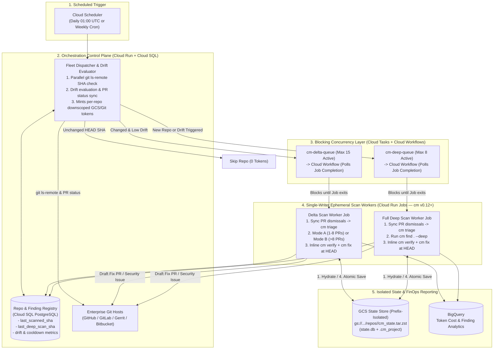
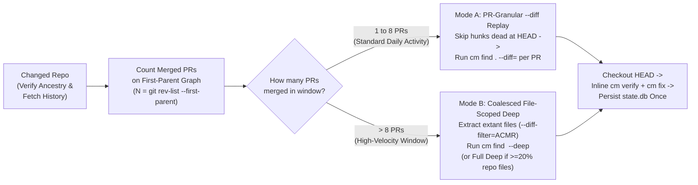
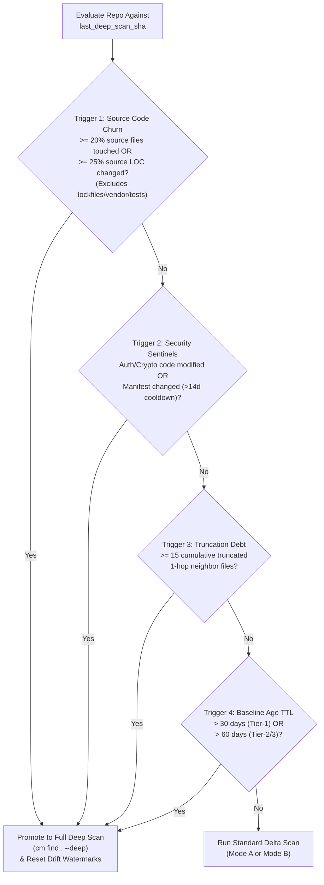
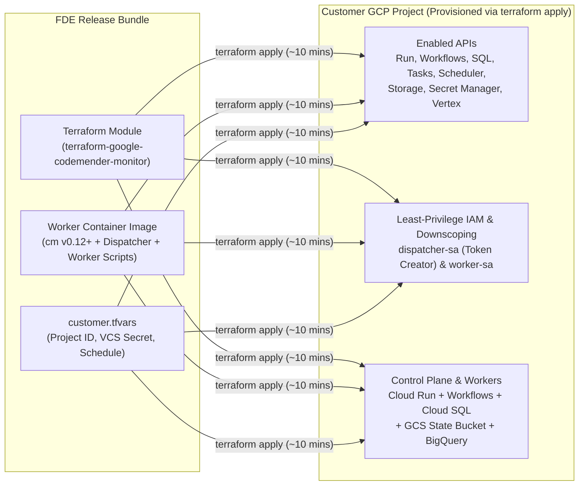

# Continuous Multi-Repository Security Monitoring with CodeMender

**Author:** Kui Luo (`kuiluo@`)

---

## 1. Executive Summary

Enterprise security teams adopting **CodeMender (`cm` v0.12+)** need a centralized, automated architecture to continuously monitor **100+ repositories** on a recurring **daily or weekly schedule** without requiring developer intervention or per-repository CI/CD pipeline modifications.

Running full repository-wide deep scans (`cm find . --deep`) on every repository every day or week is impractical for four reasons:

1. **Redundant Token Spend**: On any given day, 70%–80% of enterprise repositories have zero new commits, and active repositories typically change <2% of their files. Re-auditing unchanged code wastes 85%–90% of LLM tokens.
2. **The `cm --diff` Single-PR Constraint**: CodeMender's delta scan (`cm find . --diff`) is designed to audit a **single pull request** and caps 1-hop caller/callee neighbor expansion at 10 files (`--diff-max-neighbors=10`). Running a single `--diff` command across an entire day or week of merged commits truncates neighbor expansion and blurs attribution across multiple authors.
3. **Ephemeral Container State Loss & Concurrency Races**: CodeMender stores finding lifecycles (`OPEN`, `FIXED`, `DISMISSED`, `REOPENED`) in a local SQLite database (`$CM_HOME/state.db`) linked via a `.cm_project` marker. Without serialized per-repository state persistence, ephemeral scan workers either lose dismissed false positives or overwrite each other's SQLite state.
4. **Silent Repository Drift**: Relying exclusively on incremental delta scans forever misses multi-hop dataflow changes (3+ hops away) and global architectural shifts (such as auth middleware or dependency upgrades).

### Proposed Architecture Summary

* **Pre-Flight Remote SHA Filter**: Polls remote `HEAD` SHAs (`git ls-remote`) before cloning, skipping unchanged repositories (~70%–80% daily) at **zero compute and zero token cost**.
* **Cloud Tasks + Cloud Workflows Blocking Concurrency Control**: Cloud Tasks queues throttle concurrent repository runs via **Cloud Workflows**, which invokes **Cloud Run Jobs** (`cm` v0.12+) synchronously and blocks until job completion—preventing asynchronous job-launch floods and avoiding Cloud Tasks' 30-minute HTTP timeout.
* **Hybrid Daily Delta Engine (Solving the Single-PR `--diff` Limit)**:
  * *1–8 Merged PRs (Mode A)*: Replays `cm find . --diff` **per merged PR** along the first-parent commit graph (skipping hunks superseded later in the window), preserving single-PR neighbor expansion and exact PR/author attribution.
  * *>8 Merged PRs (Mode B)*: Coalesces extant modified source files (`--diff-filter=ACMR`) into a **File-Scoped Deep Scan** (`cm find <changed_files...> --deep`), auditing changed files and their 1-hop dependency closure in parallel (automatically promoting to full `--deep` if $\ge 20\%$ of repo files changed).
* **Noise-Resistant Repository Drift Detection**: Tracks four drift signals—**Source-Only File/LOC Churn ($\ge 20\%$ excluding lockfiles/vendor)**, **Security Sentinel Code Edits & Cooldown-Gated Manifest Bumps**, **Accumulated Neighbor Truncation Debt ($\ge 15$ files)**, and **Maximum Baseline Age TTL (30–60 days)**—to automatically promote drifted repositories to a full `--deep` re-baseline.
* **Single-Writer Per-Repo GCS State Hydration & Inline Verify/Fix**: Executes `cm find`, `cm verify`, and `cm fix` sequentially inside a single per-repository worker execution using a **prefix-downscoped GCS token**, eliminating SQLite split-brain races and syncing rejected Fix PRs back into `state.db` as `DISMISSED`.
* **Turnkey Multi-Customer Terraform Deployment**: Packages the entire Google Cloud control plane, workflows, queues, state storage, and Cloud Run workers into a reusable Terraform module (`terraform-google-codemender-monitor`).

---

## 2. CodeMender (`cm` v0.12+) Scan Primitives

CodeMender (`cm` v0.12+) operates as a split architecture where a lightweight local CLI worker communicates with the cloud-hosted Gemini Enterprise Agent Platform (`gemini-3.8-flash` default, `gemini-3.8-flash-cyber` for verification and high-assurance scans).

| Scan Primitive | CLI Invocation | Scope Audited | Default Workers | Avg Runtime | Role in Continuous Monitoring |
| :--- | :--- | :--- | :--- | :--- | :--- |
| **Single-PR Diff Scan** | `cm find . --diff=<ref>` | Modified hunks + 1-hop callers/callees (capped at 10–15 neighbors) | 4 workers | **1–2 mins** | **Mode A: PR-Granular Delta Replay** (1–8 merged PRs since last scan) |
| **File-Scoped Deep Scan** | `cm find <files...> --deep` | Specified extant changed files + immediate 1-hop dependency closure | 8 workers | **2–5 mins** | **Mode B: Coalesced Delta Scan** (>8 merged PRs, <20% repo files) |
| **Full Repo Deep Scan** | `cm find . --deep` | Every tracked source file in the repository | 8 workers | **10–20 mins** | **Initial onboarding** & **Drift-triggered re-baseline** |

---

## 3. Goals & Non-Goals

### 3.1 Goals
* **G1 — Turnkey Scale for 100+ Repositories**: Centrally monitor 100–500 repositories on a daily or weekly schedule from a single Google Cloud control plane, completing daily fleet runs in **< 45 minutes**.
* **G2 — Solve Multi-PR Daily Delta Scanning**: Overcome `cm --diff`'s single-PR design so daily and weekly delta scans achieve full 1-hop neighbor coverage and exact PR/author attribution across multiple merged commits.
* **G3 — Noise-Resistant Drift Detection**: Automatically detect when a repository has drifted sufficiently from its last full baseline to trigger a new `cm find . --deep` scan, without false-positive deep scan storms from lockfiles or Dependabot bumps.
* **G4 — Conflict-Free Persistent Finding Memory**: Preserve `OPEN`, `FIXED`, `DISMISSED`, and `REOPENED` finding states across ephemeral container runs with strictly serialized single-writer updates per repository.
* **G5 — Predictable Low Cost & Portable Deployment**: Reduce recurring steady-state token spend by **85%–90%** compared to naive full-repo deep scans, and support repeatable 1-click Terraform deployment across customer GCP environments.

### 3.2 Non-Goals
* **NG1 — Inline CI/CD Pull Request Gating**: This design focuses strictly on scheduled out-of-band repository monitoring (daily/weekly sweeps), not synchronous CI/CD PR checks.
* **NG2 — Third-Party SAST / Wiz Ingestion**: Importing external scanner reports (`cm report import`) is out of scope for this document.
* **NG3 — Mandatory Per-Repo Build Containers**: By default, verification runs statically (`cm verify --skip-exploit-verification`) so repositories do not need custom build/test containers to be monitored.

---

## 4. End-to-End System Architecture

### 4.1 Core Component Responsibilities & Concurrency Design

* **Cloud Scheduler**: Triggers the Fleet Dispatcher once per day (e.g., `01:00 UTC`) or once per week.
* **Fleet Dispatcher & Drift Evaluator (Cloud Run Service)**:
  * Reads the 100+ monitored repositories from Cloud SQL and runs parallel `git ls-remote` checks against the Git host to compare remote `HEAD` against `last_scanned_sha` (< 5 seconds for 100–500 repos).
  * Skips unchanged repositories immediately. For changed repositories, evaluates the **Drift Detection Model** (Section 6), mints a **per-repository downscoped GCS token** (`repos/<repo_id>/*`) and repo-scoped Git token, and enqueues the task to `cm-delta-queue` or `cm-deep-queue` (deduplicated by `task_id = <repo_id>-<head_sha>`).
* **Cloud Tasks + Cloud Workflows Blocking Concurrency Layer**:
  * *Why Cloud Workflows bridges Cloud Tasks and Cloud Run Jobs*: Invoking the Cloud Run Jobs API (`POST .../jobs/<job>:run`) directly from an HTTP Cloud Task returns `200 OK` in < 200ms as soon as the container starts, which would cause Cloud Tasks to immediately dispatch all 100+ jobs simultaneously. Conversely, running scans inside a Cloud Run *Service* would hit Cloud Tasks' hard 30-minute HTTP timeout.
  * *Solution*: Cloud Tasks dispatches to a **Cloud Workflow (`cm-job-runner`)** with `max_concurrent_dispatches = 15` (delta) and `8` (deep). The Cloud Workflow invokes the Cloud Run Job using the blocking connector (`googleapis.run.v1.namespaces.jobs.run`, which polls the long-running operation up to 60+ minutes) and only returns `200 OK` to Cloud Tasks when the container exits.
* **Single-Writer Ephemeral Scan Workers (Cloud Run Jobs — `cm` v0.12+)**:
  * To prevent SQLite split-brain race conditions on `state.db`, **finding discovery (`cm find`), verification (`cm verify`), and patch synthesis (`cm fix`) execute sequentially inside the same repository worker job** before uploading `cm_state.tar.zst` once at the end of the run.

---

## 5. Daily & Weekly Delta Scans: Overcoming the Single-PR `--diff` Limitation

### 5.1 Why `cm find --diff` Cannot Be Run Naively Across a Multi-PR Window

CodeMender's `--diff` flag (`cm find . --diff=<base_ref>`) was purpose-built to audit a **single pull request**:
1. **Global 1-Hop Neighbor Cap (`--diff-max-neighbors=10`)**: When `cm find . --diff` runs, it identifies modified symbols and resolves 1-hop caller/callee neighbor files across the repository, capping inspected neighbors at **10 files total** per invocation. If a repository merges 10 PRs in a day (or 35 PRs in a week), running a single `cm find . --diff=<last_scanned_sha>` across the cumulative commit range immediately exceeds the neighbor cap (`WARNING: Impact expansion truncated`), leaving dozens of impacted caller/callee files uninspected.
2. **Merged-Diff Context Dilution & Lost Attribution**: A single cumulative diff across a full day or week flattens commits from multiple engineers into one large hunk. If PR #1 weakens a sanitizer in `pkg/auth.go` and triggers an exploitable path in an untouched neighbor file `api/admin.go`, a cumulative diff cannot tell which of the day's 10 merged PRs caused the regression.
3. **64 KB Inline File Preview Truncation**: Large multi-PR diffs exceed the agent's inline preview window, forcing extra tool round-trips and reducing accuracy.

---

### 5.2 Proposed Solution: Adaptive Two-Mode Delta Engine

Before running a delta scan, the **Delta Scan Worker** clones the repository with commit history back to `last_deep_scan_at` (`git clone --shallow-since=<last_deep_scan_date>`) and verifies commit ancestry (`git merge-base --is-ancestor <last_scanned_sha> HEAD`):
* **Force-Push / History Rewrite Fallback**: If `last_scanned_sha` is no longer an ancestor of `HEAD` (due to a force-push or branch reset), the worker falls back to `last_deep_scan_sha` (or promotes the run to a Full Deep Scan if `last_deep_scan_sha` is also unreachable).
* **PR Counting & Mode Selection**: The worker counts first-parent commits in `last_scanned_sha..HEAD` (`git rev-list --first-parent --reverse <last_scanned_sha>..HEAD`) and selects **Mode A** or **Mode B**:

#### Mode A: PR-Granular `--diff` Replay (Default for 1–8 Merged PRs)
When a repository has **1 to 8 merged PRs** (or first-parent commits) since `last_scanned_sha`:
* **Live-at-HEAD Hunk Guard (Avoiding Dead Code Audits)**: Before replaying commit $C_i$, the worker compares $C_i$'s touched lines against `HEAD`. If a commit's changes were completely reverted or overwritten by a subsequent commit $C_j$ in the same window, $C_i$ is skipped—saving tokens and preventing phantom findings on dead code.
* **Per-PR Execution**: For each surviving commit $C_i$ (with parent $C_{i-1}$), the worker checks out $C_i$ and executes:
  `cm find . --diff=C_{i-1} --diff-depth=1 --diff-max-neighbors=15 --diff-workers=4`
* **Deferred Verification at `HEAD`**: Rather than running `cm verify` and `cm fix` on intermediate historical checkouts, the worker finishes replaying $C_1 \dots C_k$, checks out `HEAD`, and runs `cm verify` + `cm fix` once on any net-new `OPEN` findings that remain live at `HEAD`.
* **Why this solves the single-PR limitation**:
  1. **Zero Neighbor Truncation**: Each `cm find --diff` invocation audits a single PR, keeping its 1-hop neighbor cluster well within the 15-file limit.
  2. **Exact PR & Author Attribution (Including 1-Hop Regressions)**: Because each discovery pass is isolated to $C_{i-1} \to C_i$, any net-new finding—even in an untouched 1-hop caller/callee neighbor file—is 100% attributable to PR $C_i$ and its author.
  3. **Shared `state.db` Continuity**: All replay steps read and write the same local `$CM_HOME/state.db`, so a vulnerability introduced in $C_1$ is deduplicated across $C_2 \dots C_k$.

#### Mode B: Coalesced File-Scoped Deep Scan (For >8 Merged PRs / High-Velocity Windows)
When a busy repository merges **more than 8 PRs** in a daily or weekly window (where replaying 15–30 individual `--diff` runs would repeatedly re-scan shared files):
* **Extant Source File Extraction (`--diff-filter=ACMR`)**: The worker extracts the deduplicated list of **currently existing** source files modified in `<last_scanned_sha>..HEAD`:
  `git diff --name-only --diff-filter=ACMR <last_scanned_sha>..HEAD`
  *(Using `--diff-filter=ACMR` excludes deleted (`D`) files that would otherwise cause `cm find <file>` to fail with a file-not-found error, and path filtering strips non-code assets and lockfiles).*
* **20% Churn Promotion Guard**: If the count of modified source files in Mode B is **$\ge 20\%$ of total repository source files** (e.g., a bulk refactor or formatting sweep), the worker automatically promotes the scan to a **Full Repository Deep Scan (`cm find . --deep`)** so drift watermarks are reset. Otherwise, it invokes **File-Scoped Deep Scan**:
  `cm find <changed_file_1> <changed_file_2> ... --deep --deep-workers=8`
* **Built-In Dependency Closure**: CodeMender's discovery engine (`resolveProvidedFileNeighbors`) automatically scopes the deep audit to **the provided changed files plus their immediate 1-hop dependency closure**.
* **Post-Scan Attribution**: Net-new findings discovered in Mode B are attributed via:
  1. **Direct Hunk Blame**: `git log -L <start>,<end>:<file> <last_scanned_sha>..HEAD` if the vulnerable lines were directly edited in the window.
  2. **Symbol Caller/Callee Correlation**: Matches modified exported symbols in `<last_scanned_sha>..HEAD` if the finding occurred in an untouched 1-hop neighbor file.

---

## 6. Repository Drift Detection: When to Start a New Deep Scan

Even with accurate daily or weekly delta scans, a repository's security posture gradually drifts from its initial full baseline (`last_deep_scan_sha`) due to **3+ hop transitive code changes**, **global framework/middleware updates**, and **accumulated neighbor truncations**.

To prevent blind spots without running wasteful weekly `--deep` scans on stable repositories—or triggering false-positive deep scan storms on lockfile updates—the Fleet Dispatcher computes a **Noise-Resistant Repository Drift Check** before every scheduled scan.

### 6.1 The Four Drift Triggers

A repository is automatically promoted from a Delta Scan to a **Full Repository Deep Scan (`cm find . --deep`)** when **any** of the following four conditions is met:

#### 1. Source-Only Codebase Churn Threshold ($\ge 20\%$ Source Files or $\ge 25\%$ Source LOC)
* **Measurement**: Compares `HEAD` against `last_deep_scan_sha` using pathspec exclusions that strip out lockfiles, vendor directories, generated code, and unit tests:
  `git diff --shortstat <last_deep_scan_sha>..HEAD -- . ':!*.lock' ':!package-lock.json' ':!go.sum' ':!vendor/' ':!*_test.*'`
* **Threshold**: Promoting to `--deep` when **$\ge 20\%$ of first-party source files** or **$\ge 25\%$ of first-party source LOC** have changed ensures a fresh whole-repo audit after major feature waves while ignoring 20,000-line `package-lock.json` bumps.

#### 2. Security Sentinel Code Changes & Cooldown-Gated Manifest Updates
* **Split Evaluation Rule (Preventing Dependabot Deep-Scan Storms)**:
  * ** Tier-2A — First-Party Security Sentinel Code (Immediate Trigger)**: Any modification to global authentication, authorization, session, cryptography, or root API router packages (`**/auth/**`, `**/security/**`, `**/crypto/**`, `**/middleware/**`) immediately promotes the repository to `cm find . --deep`, as a subtle change in an auth middleware can alter taint sanitization invariants 3+ hops away.
  * **Tier-2B — Dependency & Build Manifests (14-Day Cooldown Gate)**: Modifications to `go.mod`, `package.json`, `requirements.txt`, `pom.xml`, or `build.gradle` promote the repository to `cm find . --deep` **only if `now() - last_deep_scan_at >= 14 days`**. This prevents repositories with daily or weekly Dependabot/Renovate bots from running redundant full-repo deep scans multiple times a week.

#### 3. Accumulated Neighbor Truncation Debt ($\ge 15$ Truncated Files)
* **Measurement**: Whenever a `--diff` scan logs `WARNING: Impact expansion truncated (X candidate files identified, capped at Y)`, the worker adds $(X - Y)$ to `truncated_neighbors_since_deep` in Cloud SQL.
* **Threshold**: Once **$\ge 15$ candidate neighbor files** have been skipped due to truncation since the last deep scan (or if a single diff truncates $>50\%$ of its candidate neighbors), the repository is promoted to a full `--deep` scan.

#### 4. Maximum Baseline Age TTL (30 Days for Tier-1 / 60 Days for Tier-2 & Tier-3)
* **Measurement**: Compares `now() - last_deep_scan_at` against the repository's risk tier SLA (or when `last_scanned_sha` was force-pushed and `last_deep_scan_sha` is no longer an ancestor of `HEAD`).
* **Pacing Cap**: To avoid weekend quota spikes, TTL-triggered deep scans are staggered by `crc32(repo_id)` so at most **10% of the fleet** (e.g., 10 repos/day in a 100-repo fleet) runs a scheduled `--deep` refresh on any single day.

### 6.2 Watermark Reset on Deep Scan Completion
Whenever a full `cm find . --deep` scan completes successfully:
1. `last_deep_scan_sha` and `last_scanned_sha` are both updated to `HEAD`, and `last_deep_scan_at` is set to `now()`.
2. `cumulative_churn_pct` and `truncated_neighbors_since_deep` are reset to `0`.
3. Any previously `OPEN` finding in `state.db` whose file still exists at `HEAD` but was no longer detected by the full audit is reconciled.

---

## 7. State Management, Verification & Closed-Loop Remediation

### 7.1 Single-Writer Per-Repository State Hydration in GCS
Because CodeMender keys its local SQLite database (`$CM_HOME/state.db`) by the UUID stored in `<repo_root>/.cm_project`, each ephemeral worker preserves state continuity across runs via a compressed GCS archive (`gs://<bucket>/repos/<repo_id>/cm_state.tar.zst`) with **strict single-writer serialization**:
1. **Before Scanning (Hydration & Closed-Loop PR Sync)**:
   * Using its prefix-downscoped GCS token (`repos/<repo_id>/*`), the worker downloads and extracts `state.db`, `.cm_project`, and `config.yaml` into `$CM_HOME`, copies `.cm_project` into the cloned repo root, and hides it via `.git/info/exclude`.
   * **Closed-Loop PR Dismissal Sync**: If any previously opened CodeMender Fix PR or Security Issue for this repository was closed by a developer/reviewer with a `false-positive` or `wontfix` label since the last run, the worker executes `cm triage <finding_id> --status=dismissed --notes="Dismissed via PR review"` before starting the scan.
2. **During Scanning**: CodeMender checks `state.db` by finding fingerprint (`SHA256(file_path + vuln_type + normalized_snippet)[:16]`). Previously `DISMISSED` false positives remain muted, and re-introduced vulnerabilities automatically transition from `FIXED` to `REOPENED`.
3. **Inline Verify & Fix (Zero Split-Brain)**: Immediately after `cm find` finishes at `HEAD`, the **same worker container** runs `cm verify` and `cm fix` on net-new `CRITICAL` and `HIGH` findings.
4. **After Scanning (Atomic Upload)**: The worker repackages `state.db` and `.cm_project` and uploads `cm_state.tar.zst` to GCS using atomic generation preconditions (`--if-generation-match`). Because `cm find`, `cm verify`, and `cm fix` all run inside a single serialized job per repository, there are zero concurrent writers to `state.db`.

### 7.2 Static-by-Default Verification & Tiered Patch Delivery
For every net-new `CRITICAL` or `HIGH` finding at `HEAD` (excluding pre-existing `[LEGACY / UNTOUCHED]` neighbor warnings during delta scans):
* **Default Static Verification**: Runs `cm verify <finding_id> --skip-exploit-verification --model=gemini-3.8-flash-cyber`. This performs deep multi-turn taint and reachability verification without requiring a project-specific build container. False positives are automatically marked `DISMISSED` in `state.db`.
* **Opt-In Dynamic Verification (Tier-1 Repos)**: Repositories that provide a build container and configure `build.command` in `config.yaml` run full `cm verify` with live PoC exploit execution in CodeMender's sandbox.
* **Tiered Patch Delivery (Avoiding Uncompiled Broken PRs)**:
  * **Build-Verified Repos (`--sandbox=true`)**: Confirmed findings run `cm fix <finding_id>` (which compiles and runs tests inside the sandbox) and open a **Ready-for-Review Remediation PR** assigned to the attributed commit author and `CODEOWNERS`.
  * **Static-Only Repos (`--sandbox=false`)**: Confirmed findings run `cm fix <finding_id> --sandbox=false` to synthesize a minimal unified diff patch and attach the patch to a **Draft PR or Security Issue/Ticket** (configurable per repo), preventing uncompiled patches from breaking developer CI pipelines while still delivering a 1-click patch.

---

## 8. Cost Estimate Summary (100–250 Repositories)

The tables below summarize both the **One-Time Day-1 Onboarding Cost** and the **Recurring Monthly Steady-State Cost** (LLM tokens + Google Cloud infrastructure) for monitoring 100 and 250 enterprise repositories. See **Section 11 (References & Cost Estimation Methodology)** for the underlying empirical token formulas, Vertex AI pricing rules, and Google Cloud Pricing Calculator SKU breakdowns.

### 8.1 Recurring Monthly Steady-State Cost Comparison (100 Repositories)

| Scanning Strategy | Monthly Scan Volume (100 Repos) | Est. Monthly Tokens | Est. Monthly LLM Cost | Est. GCP Infra Cost (Run + Workflows + SQL + GCS) | **Total Recurring Monthly Cost (100 Repos)** |
| :--- | :--- | :--- | :--- | :--- | :--- |
| **1. Naive Daily `--deep` (Anti-Pattern)** | 3,000 full deep scans / mo | ~3,600M tokens | ~$2,520 / mo | ~$180 / mo | **~$2,700 / mo** *(Baseline)* |
| **2. Naive Weekly `--deep` (Anti-Pattern)** | 430 full deep scans / mo | ~516M tokens | ~$361 / mo | ~$54 / mo | **~$415 / mo** |
| **3. Proposed Daily Delta + Drift-Triggered `--deep`** | ~2,100 skipped (`0` tokens) ~660 delta repo-runs ~60 drift `--deep` scans | **~125M tokens** | **~$90 / mo** | **~$45 / mo*** | **~$135 / mo** *(95% savings vs. Daily Deep)* |
| **4. Proposed Weekly Delta + Drift-Triggered `--deep`** | ~215 skipped (`0` tokens) ~155 delta repo-runs ~60 drift `--deep` scans | **~95M tokens** | **~$68 / mo** | **~$35 / mo*** | **~$103 / mo** *(75% savings vs. Weekly Deep)* |

*\*Note: If the customer's Git host (e.g., self-hosted GitHub Enterprise / GitLab) requires static egress IP allowlisting via **Cloud NAT + VPC Direct Egress**, add **~$38/mo** in fixed GCP networking cost.*

### 8.2 One-Time Onboarding Cost & Scaling to 250 Repositories

| Fleet Size | One-Time Day-1 Baseline Onboarding Cost (Initial `--deep` + Backlog Verify/Fix) | Recurring Monthly Cost (Daily Delta + Drift `--deep`) | Recurring Monthly Cost (Weekly Delta + Drift `--deep`) | Avg Daily Wall-Clock Duration (15 Concurrent Workers) |
| :--- | :--- | :--- | :--- | :--- |
| **100 Repositories** | **~$125 one-time** (~170M tokens) | **~$135 / month** (~$1,620 / yr) | **~$103 / month** (~$1,236 / yr) | **~12–18 minutes / day** |
| **250 Repositories** | **~$310 one-time** (~425M tokens) | **~$320 / month** (~$3,840 / yr) | **~$240 / month** (~$2,880 / yr) | **~25–35 minutes / day** |

> [!TIP]
> **Key FinOps Takeaway**: Because the Pre-Flight SHA Filter eliminates 70%–80% of daily repository invocations at zero cost and PR-Granular Delta Replay uses ~94% fewer tokens than a full `--deep` scan, enterprises get continuous **daily** security monitoring for barely more than the cost of weekly sweeps (**~$135/mo vs. ~$103/mo** for 100 repositories).

---

## 9. Automated Multi-Customer GCP Deployment (Terraform Blueprint)

To deploy this architecture repeatably across different enterprise customers' Google Cloud environments without manual console setup, the entire stack is packaged as a self-contained **Terraform Module (`terraform-google-codemender-monitor`)** paired with a pre-built worker container image.

### 9.1 Terraform Deployment Architecture

### 9.2 Modular Terraform File Structure & Tenant Isolation

| Terraform Module File | Provisioned Google Cloud Resources | Purpose |
| :--- | :--- | :--- |
| **`apis.tf`** | `google_project_service` | Enables Cloud Run, Cloud Workflows, Cloud SQL, Cloud Tasks, Cloud Scheduler, Cloud Storage, Secret Manager, STS (Token Downscoping), BigQuery, and Vertex AI / Agent Platform APIs. |
| **`iam.tf`** | `google_service_account`, `google_project_iam_member` | Creates `cm-dispatcher-sa` and `cm-worker-sa`. **Blast-Radius Isolation**: Rather than giving `cm-worker-sa` wildcard access to all repos in GCS, `cm-dispatcher-sa` mints a **per-repo Credential Access Boundary (Downscoped GCS token)** restricted to `gs://cm-state-<project_id>/repos/<repo_id>/*` and a repo-scoped Git installation token for each job invocation. |
| **`storage_sql.tf`** | `google_storage_bucket`, `google_sql_database_instance` | Creates the versioned GCS bucket (`cm-state-<project_id>`) for `cm_state.tar.zst` archives and the private Cloud SQL PostgreSQL instance initialized with `repo_registry` and `attributed_findings`. |
| **`queues_workflows.tf`** | `google_cloud_tasks_queue`, `google_workflows_workflow`, `google_cloud_scheduler_job` | Provisions `cm-delta-queue` (max 15 concurrent) and `cm-deep-queue` (max 8 concurrent), the blocking **Cloud Workflow (`cm-job-runner`)** that polls Cloud Run Job completion, and the daily/weekly Cloud Scheduler trigger. |
| **`cloud_run.tf`** | `google_cloud_run_v2_service`, `google_cloud_run_v2_job` | Deploys the **Fleet Dispatcher** Cloud Run Service and the **Cloud Run Jobs** (`cm-delta-worker`, `cm-deep-worker` with inline `verify`/`fix`) pointing to the `cm` v0.12+ container image. |
| **`bigquery.tf`** | `google_bigquery_dataset`, `google_bigquery_table` | Creates the `codemender_finops` dataset and partitioned tables for `cm stats --json` token telemetry and vulnerability SLA reporting. |

### 9.3 Customer-Specific Configuration (`customer.tfvars`)

Onboarding a new customer environment requires zero code changes—only a 6-variable `customer.tfvars` file:

| Input Variable | Example Value | Description |
| :--- | :--- | :--- |
| **`project_id`** | `"acme-sec-codemender-prod"` | Target customer GCP project ID where the monitoring stack is deployed. |
| **`region`** | `"us-central1"` | GCP region for Cloud Run, Cloud Workflows, Cloud SQL, Cloud Tasks, and GCS. |
| **`vcs_provider_config`** | `{ type = "github", secret_id = "github-app-key" }` | VCS host type (`github`, `gitlab`, `gerrit`, `bitbucket`) and Secret Manager reference for Git read/PR credentials. |
| **`repo_manifest_uri`** | `"gs://acme-sec-config/repos.yaml"` | YAML/JSON list of the 100+ repositories (or GitHub Org / GitLab Group auto-discovery filter) to monitor. |
| **`scan_schedule_cron`** | `"0 1 * * *"` *(Daily 01:00 UTC)* | Cron schedule for Cloud Scheduler (`"0 1 * * *"` for daily or `"0 2 * * 6"` for weekly Saturday runs). |
| **`drift_thresholds`** | `{ max_file_churn_pct = 20, manifest_cooldown_days = 14, ttl_days = 30 }` | Customer-tunable thresholds for the 4-Trigger Repository Drift Evaluator. |

### 9.4 Customer Onboarding & Day-2 Upgrade Lifecycle

1. **Step 1 — Container Image Staging (2 mins)**:
   * Copy or build the immutable worker image (packaging the `cm` v0.12+ binary, `git`, `jq`, and the Dispatcher/Worker scripts) into the customer's Artifact Registry (`<region>-docker.pkg.dev/<project_id>/codemender/cm-worker:v0.12`).
2. **Step 2 — Infrastructure Provisioning via `terraform apply` (8–10 mins)**:
   * Run `terraform init && terraform apply -var-file="customer.tfvars"`.
   * Terraform provisions all networking, IAM, Cloud SQL tables, GCS buckets, Cloud Tasks queues, Cloud Workflows, and Cloud Run services/jobs automatically.
3. **Step 3 — VCS Credential Binding & Automated Day-1 Baseline Seeding**:
   * The customer populates the Secret Manager secret with their GitHub App private key / GitLab Group Token.
   * On the first scheduled run, the Dispatcher imports `repos.yaml`, detects `last_scanned_sha IS NULL` for the 100+ repositories, and automatically trickles initial `cm find . --deep` onboarding scans across `cm-deep-queue` in controlled waves (e.g., 20–25 repos/day) so quotas are never exceeded.
4. **Step 4 — Zero-Downtime Day-2 Upgrades**:
   * When a new CodeMender CLI version is released (e.g., `v0.13+`), the customer simply updates `worker_image_tag = "v0.13"` in `customer.tfvars` and runs `terraform apply` to roll out the new Cloud Run Job revision across all 100+ repositories.

---

## 10. Implementation & Rollout Plan

### Phase 1: Terraform Deployment & Baseline Onboarding (Week 1)
* Run `terraform apply` in the target GCP project to provision Cloud SQL, GCS state storage, Cloud Tasks queues, Cloud Workflows, and Cloud Run Jobs with `cm` v0.12+.
* Seed the initial 100+ repositories in staggered batches of 20–25 repos/day using `cm find . --deep` to hydrate each repository's initial `state.db` and `.cm_project` archive in GCS and record `last_deep_scan_sha = HEAD`.

### Phase 2: Daily/Weekly Delta Replay & Inline Static Verification (Week 2)
* Enable the daily (or weekly) Cloud Scheduler trigger, Dispatcher `git ls-remote` pre-flight check, and closed-loop PR dismissal sync (`cm triage --status=dismissed`).
* Activate **Mode A (PR-Granular `--diff` Replay with live-at-HEAD hunk guard)** for 1–8 merged PRs and **Mode B (File-Scoped `--deep` with `--diff-filter=ACMR`)** for >8 merged PRs.
* Enable inline `cm verify --skip-exploit-verification` and `cm fix --sandbox=false` at `HEAD` to automatically dismiss false positives and open Draft Fix PRs / Security Issues for verified `CRITICAL`/`HIGH` findings.

### Phase 3: Noise-Resistant Drift Detection & FinOps Telemetry (Week 3)
* Enable the **Four-Trigger Drift Evaluator** (20% source-only file churn, security sentinel code monitoring + 14-day manifest cooldown, 15-neighbor truncation debt cap, and 30/60-day TTL) to automatically promote drifted repositories to `cm-deep-queue`.
* Connect `cm stats --json` exports to BigQuery to track per-repository token spend, drift frequency, and verification dismissal rates.

---

## 11. References & Cost Estimation Methodology

### 11.1 Architectural References
* [CodeMender Public Documentation (`cm` v0.12+)](https://docs.cloud.google.com/gemini-enterprise-agent-platform/agents/codemender)
* Internal CodeMender Deep Find Architecture & Benchmark Telemetry (`cl/976766121`, `go/codemender-rfc-20`)

### 11.2 Cost Estimation Rules & Pricing Formulas

All cost figures in **Section 8** are derived from three explicit estimation rules and pricing references:

#### Rule 1: Empirical Token Consumption Model (From `cm stats` & Deep Find Benchmarks)
Token counts per scan operation are derived from internal CodeMender Deep Find benchmark runs (`cl/976766121`) and `cm stats --json` session telemetry on representative enterprise repositories averaging **250 source files (~50,000 LOC)**:
* **Full Repository Deep Scan (`cm find . --deep`, 8 workers)**: After Tier-0 AST pruning (which filters out unit tests, mocks, and static schema files), CodeMender audits ~220–250 files in **2-file micro-batches** (~125 batches/repo). Each micro-batch consumes ~8.5k input tokens (system prompt + file source + tool calls) and ~1.1k output/thinking tokens:
  $$\text{Tokens}_{\text{deep}} = 125\text{ batches} \times 9.6\text{k tokens/batch} \approx \mathbf{1.2\text{M tokens/repo}} \quad (88\%\text{ input},\; 12\%\text{ output})$$
* **Single-PR Diff Scan (`cm find . --diff`, 4 workers)**: Audits an average of 2–3 modified files plus 4–6 1-hop neighbor files (~3 micro-batches) = **~30k tokens per merged PR**. For an active repository averaging 2.5 merged PRs/day, daily delta replay consumes **~75k tokens per active repo-day**.
* **Coalesced File-Scoped Deep Scan (Mode B)**: Audits ~12–15 unique extant modified files + 1-hop dependency closure (~18 micro-batches) = **~180k tokens per high-velocity repo-day**.
* **Inline Static Verification & Patch Synthesis (`cm verify` + `cm fix`)**: Multi-turn taint verification (`gemini-3.8-flash-cyber`, ~25% thinking/output ratio) + unified diff patch synthesis = **~50k tokens per net-new `CRITICAL`/`HIGH` finding**.

#### Rule 2: Vertex AI / Gemini Enterprise Agent Platform Token Pricing Formula
LLM token costs are calculated using published **Google Cloud Vertex AI Gemini Flash (`gemini-3.8-flash` / `gemini-3.8-flash-cyber`) pay-as-you-go rates**:
* **Input Token Rate**: ~$0.40 per 1M input tokens (blended standard/cached context)
* **Output & Thinking Token Rate**: ~$2.90 per 1M output tokens
* **Blended Effective Rate (at 88% Input / 12% Output Split)**:
  $$\text{Rate}_{\text{blended}} = (0.88 \times \$0.40) + (0.12 \times \$2.90) = \$0.352 + \$0.348 = \mathbf{\$0.70\text{ per 1M total tokens}}$$
* **One-Time Day-1 Onboarding Derivation (100 Repositories)**:
  * *Initial Full `--deep` Baseline*: $100\text{ repos} \times 1.2\text{M tokens} = 120\text{M tokens}$
  * *Initial Legacy Backlog Verify & Fix (~10 findings/repo)*: $1,000\text{ findings} \times 50\text{k tokens} = 50\text{M tokens}$
  * *Total One-Time Onboarding*: $170\text{M tokens} \times \$0.70/\text{1M} \approx \mathbf{\$119\text{–}\$125\text{ one-time}}$.
* **Recurring Monthly Steady-State Derivation (100 Repositories)** (assuming 30% of repos have commits on a given workday = 22 workdays/mo, and 15% of repos trigger a drift `--deep` scan each week):
  * *Daily Delta Replay*: $30\text{ active repos/day} \times 22\text{ workdays} \times 75\text{k tokens} = \mathbf{49.5\text{M tokens/mo}}$
  * *Drift-Triggered `--deep` Scans*: $15\text{ drifted repos/week} \times 4\text{ weeks} \times 1.2\text{M tokens} = \mathbf{72.0\text{M tokens/mo}}$
  * *Inline Verify & Fix (~70 net-new findings/mo)*: $70\text{ findings} \times 50\text{k tokens} = \mathbf{3.5\text{M tokens/mo}}$
  * *Total Recurring Monthly Tokens*: $49.5\text{M} + 72.0\text{M} + 3.5\text{M} = \mathbf{125\text{M tokens/mo}} \times \$0.70/\text{1M} \approx \mathbf{\$88\text{–}\$90/\text{mo}}$.

#### Rule 3: Google Cloud Pricing Calculator Rules for Serverless Infrastructure (`us-central1`)
Infrastructure costs are calculated using standard **Google Cloud Pricing Calculator (`us-central1` Tier-1)** SKU rates:
* **Cloud Run Jobs (Worker Compute)**: Each worker container runs with `2 vCPU, 4 GiB RAM` (`$0.00002400 / vCPU-sec` + `$0.00000250 / GiB-sec` = **~$0.0035 per container-minute**).
  * *Proposed Daily Strategy*: $(660\text{ delta runs} \times 3\text{ mins}) + (60\text{ deep runs} \times 15\text{ mins}) = 2,880\text{ container-mins/mo} \times \$0.0035 \approx \mathbf{\$10/\text{mo}}$.
  * *Naive Daily `--deep` Baseline*: $3,000\text{ deep runs} \times 15\text{ mins} = 45,000\text{ container-mins/mo} \times \$0.0035 \approx \mathbf{\$158/\text{mo}}$.
* **Cloud SQL for PostgreSQL**: 1 regional lightweight `db-g1-small` instance (`1 shared vCPU, 1.7 GB RAM, 10 GB SSD`) for `repo_registry` and `attributed_findings` = **~$28–$30/mo**.
* **Cloud Workflows, Cloud Tasks, Cloud Storage, Scheduler & BigQuery**: ~3,000 Cloud Workflow internal steps/mo (free tier covers first 5,000 steps/mo, then `$0.00001/step`), < 5 GB of compressed `cm_state.tar.zst` archives (`$0.020/GB-mo`), 1 Cloud Scheduler job, and < 1 GB BigQuery telemetry = **~$5/mo**.
* **Total Baseline GCP Infrastructure (100 Repos)**: $\$10 + \$30 + \$5 = \mathbf{\$45/\text{mo}}$ *(plus ~$38/mo if Cloud NAT static egress IP is required for on-prem/firewalled Git hosts)*.
